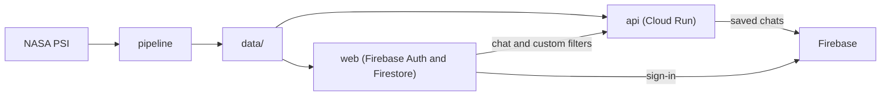

# FlameMind

FlameMind helps a spacecraft designer find what NASA combustion tests measured for a habitat atmosphere. Team Spherical Flame built it for the NASA Space Apps challenge Flame in Freefall. Fires in microgravity, and fires in a high-oxygen lunar habitat, do not behave like fires on Earth, and the Physical Sciences Informatics (PSI) Combustion Science record is about 12 TB across 24 investigations. FlameMind indexes the knowledge layer of all 24 investigations, links every result to its PSI folder, and lets a person ask a question, filter the tests, compare investigations, rank them for a habitat, and see which atmospheres were never tested.

## Screenshots

The image files are not in the repository yet. Replace each path before a submission.

| Page | Placeholder |
| --- | --- |
| Index, the problem | `docs/screenshots/index.png` |
| Home, oxygen presets | `docs/screenshots/home.png` |
| Scenario, a sourced answer | `docs/screenshots/scenario.png` |
| Explore, filters | `docs/screenshots/explore.png` |
| Compare | `docs/screenshots/compare.png` |
| Rank | `docs/screenshots/rank.png` |
| Gaps, tested oxygen and pressure | `docs/screenshots/gaps.png` |
| Controls | `docs/screenshots/controls.png` |
| Earth applications | `docs/screenshots/earth.png` |
| About | `docs/screenshots/about.png` |

## Architecture

`pipeline/` reads NASA PSI and writes `data/`. The API loads that JSON on Cloud Run. The Next.js app reads the same JSON at build time, calls the API for chat and custom filters, and uses Firebase Authentication and Cloud Firestore for sign-in and saved chats. Science records are not stored in Firebase.



## Run locally

Each block starts at the repository root.

### Pipeline

```bash
cd "$(git rev-parse --show-toplevel)/pipeline"
python3.11 -m venv .venv
source .venv/bin/activate
pip install -e .
cp ../.env.example ../.env   # then set every variable
pytest
python config.py             # prints "Pipeline config ok." or names the missing variables
```

`uv` works too: `uv sync` then `uv run pytest`, from `pipeline/`.

Rebuild the derived files, in order, from `pipeline/` with the virtual environment active:

```bash
python collect_psi.py    # writes data/raw/, including sources.csv; needs the network
python parse.py          # data/processed/ page text from the files named in sources.csv
python extract.py        # data/investigations.json, using Vertex AI Gemini
python gaps.py           # data/gaps.json
python insights.py       # checks the hand-written data/insights.json
python embed.py          # data/chunks.json and embeddings.npy
```

`data/raw/` is local and is not committed. `collect_psi.py` is the step that fills it.

### API

```bash
cd "$(git rev-parse --show-toplevel)/api"
python3.11 -m venv .venv
source .venv/bin/activate
pip install -r requirements.txt
pytest
uvicorn main:app --reload --port 8080
```

`GET http://127.0.0.1:8080/health` returns `{"status":"ok"}`.

The API reads `GCP_PROJECT`, `GCP_REGION`, `GEMINI_MODEL`, and `EMBED_MODEL` from the repo-root `.env`, plus:

- `WEB_ORIGIN`: the browser origins allowed by CORS, separated by commas, for example `http://localhost:3000`. If unset, no browser origin is allowed.
- `FIREBASE_PROJECT_ID`: Firebase project for sign-in and saved chats. Defaults to `GCP_PROJECT`.

At startup it loads `data/chunks.json`, `embeddings.npy`, `investigations.json`, `habitats.json`, `gaps.json`, `insights.json`, `answer_cache.json`, and `derived_cache.json` into memory.

`POST /chat` answers from those records. A guest sends the last 8 messages and nothing is saved (10 requests a minute per IP). A signed-in caller sends a Firebase ID token; omit `chat_id` to start a chat, or pass it to continue one. The chat is stored under `users/{uid}/chats/{chat_id}` (30 requests a minute per user).

`POST /filter/parse` turns free text into a filter. `POST /filter/derive` reads passages for a parameter the schema does not already store. A derived number is kept only when that number is written in the cited passage.

```bash
python prewarm.py   # answers docs/demo_questions.txt and writes data/answer_cache.json
```

Re-run `prewarm.py` after the data or the prompts in `api/ai/` change.

Build the API image from the repo root so `data/` is copied in:

```bash
cd "$(git rev-parse --show-toplevel)"
docker build -f api/Dockerfile -t flamemind-api .
docker run --rm -p 8080:8080 -e PORT=8080 --env-file .env flamemind-api
```

On Cloud Run the same variables are set on the service. The service reads the caller address from the last `X-Forwarded-For` entry.

### Web

```bash
cd "$(git rev-parse --show-toplevel)/web"
npm install
npm run dev
```

Open `http://localhost:3000`.

```bash
npm test        # vitest
npm run lint
npm run build   # type-checks and writes the static export to web/out/
```

`src/lib/data.ts` imports `data/investigations.json`, `habitats.json`, `gaps.json`, and `insights.json` at build time, so rebuild after the pipeline changes them. Types in `src/lib/types.ts` match `pipeline/schema.py`.

The site front page (`/`) is `web/index.html`, served by `web/src/app/route.ts`. `npm run build` copies it to `web/out/index.html`. Launch FlameMind opens `/home/`.

Pages: `/home/`, `/scenario/` (chat), `/explore/`, `/compare/`, `/rank/`, `/gaps/`, `/controls/`, `/earth/`, `/about/`, `/login/`, `/account/`, and `/investigations/<PSI id>/`.

The chat page and the Explore custom filter call the API. Set `NEXT_PUBLIC_API_URL` in `web/.env.local` (locally `http://127.0.0.1:8080`) and set the API's `WEB_ORIGIN` to the site origin (locally `http://localhost:3000`), then run both.

### Accounts (optional)

Sign-in uses Firebase Authentication (Google or email and password). User data lives in Cloud Firestore. Science data never does. Guests can use every page. Anything that saves shows "Sign in to save".

```
users/{uid}                                {displayName, email, createdAt, useCaseProfile?}
users/{uid}/chats/{chatId}                 {title, createdAt, updatedAt, useCase}
users/{uid}/chats/{chatId}/messages/{id}   {role, text, structured, createdAt}
users/{uid}/savedFilters/{id}              {name, manualFilters, customFilters, createdAt}
```

`firestore.rules`: a user reads only their own documents. Chats and messages are created only by the API (service account). The owner may rename or delete a chat and delete its messages. The profile and saved filters are writable by their owner.

Setup:

1. Create a Firebase project, enable Authentication (Google and Email/Password) and Firestore.
2. Copy `web/.env.example` to `web/.env.local` and fill in the `NEXT_PUBLIC_FIREBASE_*` values. Without them the site builds and runs guest-only.
3. Deploy the rules: `firebase deploy --only firestore:rules --project <project id>`.
4. Give the API credentials for that project (Application Default Credentials) and set `FIREBASE_PROJECT_ID` if it differs from `GCP_PROJECT`.

The API verifies the Firebase ID token on every request that carries one. A bad token is a 401.

```bash
curl -s http://127.0.0.1:8080/me                                               # {"signed_in": false, "uid": null}
curl -s http://127.0.0.1:8080/me -H "Authorization: Bearer $FIREBASE_ID_TOKEN"  # {"signed_in": true, "uid": "..."}
```

Tests that need the Firestore emulator (Firebase CLI and Java):

```bash
cd web && npm run test:rules
cd .. && firebase emulators:exec --only firestore --project demo-flamemind \
  "cd api && python -m pytest tests/test_store_emulator.py"
```

Local sign-in without a real project: run `firebase emulators:start --only auth,firestore --project demo-flamemind`, set `NEXT_PUBLIC_FIREBASE_EMULATORS=1` with any placeholder values for the other four variables in `web/.env.local`, and start the API with `FIREBASE_AUTH_EMULATOR_HOST=127.0.0.1:9099 FIRESTORE_EMULATOR_HOST=127.0.0.1:8085 FIREBASE_PROJECT_ID=demo-flamemind`.

## How the data was extracted and reviewed

PSI is public CC0 data. `pipeline/collect_psi.py` reads the Combustion Science investigation list, writes an overview for every investigation, and downloads only small documents and test tables for the deep tier (tier A). It does not request folder zips or raw video, images, or sensor logs. A file larger than 50 MB is not downloaded. Tier B investigations keep an overview and a publication list. The script writes `data/raw/inventory.csv` and `data/raw/sources.csv`.

`pipeline/parse.py` opens only the files named in `sources.csv` and writes page-level JSON to `data/processed/`. A file over 50 MB is logged as skipped and is not opened.

`pipeline/extract.py` asks Vertex AI Gemini to fill one investigation record from that page text and from the experiment tables. The prompt allows a value only when it is written in the source. A missing value stays null. Pressure is converted when the source gives one unit, using 1 psi = 6.894757 kPa. Every finding and every test number is stored with the file and the page marker it came from. The result is `data/investigations.json`: 24 investigations and 1652 test rows.

`pipeline/gaps.py` builds `data/gaps.json` from those tests and from the habitat presets in `data/habitats.json`. A simulated partial-gravity test is not counted as partial-gravity coverage. `data/insights.json` is written by hand. `pipeline/insights.py` checks that each insight names known investigations and cites a source that appears in one of those records.

Review is a spreadsheet, not a model step. From `pipeline/`:

```bash
python review.py export
# edit data/review/investigations.csv and data/review/tests.csv
python review.py import --initials <initials> --dry-run
python review.py import --initials <initials>
python review.py status
```

Export writes the two CSV files. Import copies back only the editable columns that are still present. A changed row is marked reviewed and `reviewed_by` is set to those initials. In the current `data/investigations.json`, 4 records are marked reviewed (PSI-25, PSI-98, PSI-101, PSI-102) and 14 are marked needs review. `reviewed_by` is empty on every record, so no reviewer initials are stored.

## NASA data used

The repository is NASA's [Physical Sciences Informatics (PSI)](https://psi.nasa.gov/) system, Combustion Science. This build uses the 24 investigations below. Publication rows, document rows, and experimental-table rows are the rows in `data/raw/sources.csv` (352 publication rows, 27 documents, 24 overviews, 10 experimental tables). A paper is listed under every investigation that cites it. One publication row is an exact duplicate of another row for the same investigation, so it is listed once. A blank year or DOI is blank in `sources.csv`.

| PSI id | Acronym | Name | Tier | PSI record |
| --- | --- | --- | --- | --- |
| PSI-10 | ACME/Flame Design | Advanced Combustion via Microgravity Experiments / Flame Design | B | [PSI-10](https://psi.nasa.gov/physci/repo/data/investigations/PSI-10) |
| PSI-20 | ACME BRE | Advanced Combustion via Microgravity Experiments - Burning Rate Emulator | A | [PSI-20](https://psi.nasa.gov/physci/repo/data/investigations/PSI-20) |
| PSI-21 | ACME CLD Flame | Advanced Combustion via Microgravity Experiments / Coflow Laminar Diffusion Flame | B | [PSI-21](https://psi.nasa.gov/physci/repo/data/investigations/PSI-21) |
| PSI-22 | ACME E-FIELD Flames | Advanced Combustion via Microgravity Experiments Electric-Field Effects on Laminar Diffusion Flames | B | [PSI-22](https://psi.nasa.gov/physci/repo/data/investigations/PSI-22) |
| PSI-23 | ACME s-Flame | Advanced Combustion via Microgravity Experiments-Structure and Response of Spherical Diffusion Flames | B | [PSI-23](https://psi.nasa.gov/physci/repo/data/investigations/PSI-23) |
| PSI-25 | BASS-II | Burning and Suppression of Solids - II | A | [PSI-25](https://psi.nasa.gov/physci/repo/data/investigations/PSI-25) |
| PSI-26 | BASS | Burning and Suppression of Solids | A | [PSI-26](https://psi.nasa.gov/physci/repo/data/investigations/PSI-26) |
| PSI-39 | CFI | Cool Flames Investigation | B | [PSI-39](https://psi.nasa.gov/physci/repo/data/investigations/PSI-39) |
| PSI-47 | DAFT / DAFT-2 | Dust and Aerosol Measurement Feasibility Test / Dust and Aerosol Measurement Feasibility Test-2 | B | [PSI-47](https://psi.nasa.gov/physci/repo/data/investigations/PSI-47) |
| PSI-60 | PSI-60 | Computational and Experimental Analysis of SPICE Data Sets | B | [PSI-60](https://psi.nasa.gov/physci/repo/data/investigations/PSI-60) |
| PSI-62 | PSI-62 | Concurrent Flame Spread Modeling using Flamelet Generated Manifolds in Microgravity with Comparison to BASS Experiments using Two-Color Tomography | B | [PSI-62](https://psi.nasa.gov/physci/repo/data/investigations/PSI-62) |
| PSI-68 | FLEX-2 | Flame Extinguishment Experiment - 2 | A | [PSI-68](https://psi.nasa.gov/physci/repo/data/investigations/PSI-68) |
| PSI-69 | FLEX | Flame Extinguishment Experiment | A | [PSI-69](https://psi.nasa.gov/physci/repo/data/investigations/PSI-69) |
| PSI-98 | SAFFIRE-I | Spacecraft Fire Safety Experiment-I | A | [PSI-98](https://psi.nasa.gov/physci/repo/data/investigations/PSI-98) |
| PSI-99 | SAFFIRE-II | Spacecraft Fire Experiment-II | A | [PSI-99](https://psi.nasa.gov/physci/repo/data/investigations/PSI-99) |
| PSI-100 | SAFFIRE-III | Spacecraft Fire Experiment-III | A | [PSI-100](https://psi.nasa.gov/physci/repo/data/investigations/PSI-100) |
| PSI-101 | SAME-R | Smoke Aerosol Measurement Experiment-Reflight | A | [PSI-101](https://psi.nasa.gov/physci/repo/data/investigations/PSI-101) |
| PSI-102 | SAME | Smoke and Aerosol Measurement Experiment | A | [PSI-102](https://psi.nasa.gov/physci/repo/data/investigations/PSI-102) |
| PSI-106 | SLICE | Structure and Liftoff In Combustion Experiment | B | [PSI-106](https://psi.nasa.gov/physci/repo/data/investigations/PSI-106) |
| PSI-107 | SPICE | Smoke Point In Co-flow Experiment | B | [PSI-107](https://psi.nasa.gov/physci/repo/data/investigations/PSI-107) |
| PSI-115 | PSI-115 | Utilization of the Smoke Aerosol Measurement Experiment Data for Advanced Modeling and Simulation of Smoke Generation in Micro-Gravity | B | [PSI-115](https://psi.nasa.gov/physci/repo/data/investigations/PSI-115) |
| PSI-117 | PSI-117 | Effect of External Thermo-Convective Perturbation on Cool Flame Dynamics: A Multidimensional Multi-Physics CFD Analysis | B | [PSI-117](https://psi.nasa.gov/physci/repo/data/investigations/PSI-117) |
| PSI-142 | PSI-142 | Quantitative Studies of Cool Flame Transitions at Radiation / Stretch Extinction Using Counterflow Flames | B | [PSI-142](https://psi.nasa.gov/physci/repo/data/investigations/PSI-142) |
| PSI-159 | ACME CFI-G | Advanced Combustion via Microgravity Experiments / Cool Flames Investigation with Gases | B | [PSI-159](https://psi.nasa.gov/physci/repo/data/investigations/PSI-159) |

### PSI-10 — ACME/Flame Design

Advanced Combustion via Microgravity Experiments / Flame Design

PSI record: https://psi.nasa.gov/physci/repo/data/investigations/PSI-10

Papers (33):

- The kinetics and warm flame chemistry associated with radiative extinction of spherical diffusion flames. Waddell Kendyl A., Irace Phillip H., Yablonsky Gregory, Constales Denis, Sunderland Peter B., Axelbaum Richard L. (2024). DOI: [10.1080/13647830.2024.2326830](https://doi.org/10.1080/13647830.2024.2326830)
- The effects of elevated pressure on the kinetics and extinction of hot, warm, and cool gaseous ethylene spherical diffusion flames. Waddell Kendyl A., Yablonsky Gregory, Constales Denis, Sunderland Peter B., Axelbaum Richard L. (2024). DOI: [10.1016/j.proci.2024.105400](https://doi.org/10.1016/j.proci.2024.105400)
- Soot Formation in Spherical Diffusion Flames. Frolov Sergey M., Ivanov Vladislav S., Frolov Fedor S., Vlasov Pavel A., Axelbaum Richard, Irace Phillip H., Yablonsky Grigoriy, Waddell Kendyl (2023). DOI: [10.3390/math11020261](https://doi.org/10.3390/math11020261)
- On the existence of steady-state gaseous microgravity spherical diffusion flames in the presence of radiation heat loss. Irace Phillip H., Waddell Kendyl A., Constales Denis, Kim Minhyeng, Yablonsky Gregory, Sunderland Peter B., Axelbaum Richard L. (2023). DOI: [10.1016/j.proci.2022.07.049](https://doi.org/10.1016/j.proci.2022.07.049)
- Critical temperature and reactant mass flux for radiative extinction of ethylene microgravity spherical diffusion flames at 1 bar. Irace Phillip H., Waddell Kendyl A., Constales Denis, Sunderland Peter B., Axelbaum Richard L. (2023). DOI: [10.1016/j.proci.2022.07.043](https://doi.org/10.1016/j.proci.2022.07.043)
- An investigation of thermal radiation from laminar diffusion flames in a tri-coflow burner with central oxygen. Irace P.H., Gopan A., Axelbaum R.L. (2022). DOI: [10.1016/j.combustflame.2022.112158](https://doi.org/10.1016/j.combustflame.2022.112158)
- Observations of long duration microgravity spherical diffusion flames aboard the International Space Station. Irace Phillip H., Lee Han Ju, Waddell Kendyl, Tan Logan, Stocker Dennis P., Sunderland Peter B., Axelbaum Richard L. (2021). DOI: [10.1016/j.combustflame.2021.02.019](https://doi.org/10.1016/j.combustflame.2021.02.019)
- SPHERICAL DIFFUSION FLAME IN MICROGRAVITY CONDITIONS: FIRST RESULTS OF JOINT RUSSIAN-AMERICAN SPACE EXPERIMENT FLAME DESIGN - ADAMANT. undefined undefined, FROLOV S. M. (2020). DOI: [10.30826/NEPCAP9B-13](https://doi.org/10.30826/NEPCAP9B-13)
- Double blue zones in inverse and normal laminar jet diffusion flames. Wang Zhengyang, Sunderland Peter B., Axelbaum Richard L. (2020). DOI: [10.1016/j.combustflame.2019.09.014](https://doi.org/10.1016/j.combustflame.2019.09.014)
- Dilution effects on laminar jet diffusion flame lengths. Wang Zhengyang, Sunderland Peter B., Axelbaum Richard L. (2019). DOI: [10.1016/j.proci.2018.06.085](https://doi.org/10.1016/j.proci.2018.06.085)
- A new method of flame temperature measurement utilizing the acoustic emissions from laser-induced plasmas. Wu Wendong, Adeosun Adewale, Axelbaum Richard L. (2019). DOI: [10.1016/j.proci.2018.07.096](https://doi.org/10.1016/j.proci.2018.07.096)
- Structure and extinction of spherical burner-stabilized diffusion flames that are attached to the burner surface. Rodenhurst Melvin K., Chao Beei-Huan, Sunderland Peter B., Axelbaum Richard L. (2018). DOI: [10.1016/j.combustflame.2017.08.024](https://doi.org/10.1016/j.combustflame.2017.08.024)
- Effects of Inert Placement (Z st) on Soot and Radiative Heat Flux in Turbulent Diffusion Flames. Gopan Akshay, Yang Zhiwei, Kumfer Benjamin M., Axelbaum Richard L. (2017). DOI: [10.1021/acs.energyfuels.7b01092](https://doi.org/10.1021/acs.energyfuels.7b01092)
- Observation of water–gas shift equilibrium in diffusion flames. Wu Wendong, Yablonsky Gregory, Axelbaum Richard L. (2016). DOI: [10.1016/j.combustflame.2016.07.025](https://doi.org/10.1016/j.combustflame.2016.07.025)
- An Approach to Thermocouple Measurements That Reduces Uncertainties in High-Temperature Environments. Krishnan Siddharth, Kumfer Benjamin M., Wu Wendong, Li Jichuan, Nehorai Arye, Axelbaum Richard L. (2015). DOI: [10.1021/acs.energyfuels.5b00071](https://doi.org/10.1021/acs.energyfuels.5b00071)
- Stability of spray combustion for water/alcohols mixtures in oxygen-enriched air. Yi Fei, Axelbaum Richard L. (2013). DOI: [10.1016/j.proci.2012.05.088](https://doi.org/10.1016/j.proci.2012.05.088)
- Simplifying the complexity of diffusion flames through interpretation in C/O ratio space. Xia Fei, Axelbaum Richard L. (2013). DOI: [10.1016/j.camwa.2013.01.008](https://doi.org/10.1016/j.camwa.2013.01.008)
- Numerical study of flame structure and soot inception interpreted in carbon-to-oxygen atom ratio space. Xia Fei, Yablonsky Gregory S., Axelbaum Richard L. (2013). DOI: [10.1016/j.proci.2012.06.043](https://doi.org/10.1016/j.proci.2012.06.043)
- Modeled quenching limits of spherical hydrogen diffusion flames. Lecoustre V.R., Sunderland P.B., Chao B.H., Axelbaum R.L. (2013). DOI: [10.1016/j.proci.2012.07.029](https://doi.org/10.1016/j.proci.2012.07.029)
- Numerical investigation of spherical diffusion flames at their sooting limits. Lecoustre V.R., Sunderland P.B., Chao B.H., Axelbaum R.L. (2012). DOI: [10.1016/j.combustflame.2011.05.022](https://doi.org/10.1016/j.combustflame.2011.05.022)
- Kinetic and radiative extinctions of spherical burner-stabilized diffusion flames. Wang Q., Chao B.H. (2011). DOI: [10.1016/j.combustflame.2010.12.007](https://doi.org/10.1016/j.combustflame.2010.12.007)
- Extremely weak hydrogen flames. Lecoustre V.R., Sunderland P.B., Chao B.H., Axelbaum R.L. (2010). DOI: [10.1016/j.combustflame.2010.07.024](https://doi.org/10.1016/j.combustflame.2010.07.024)
- Characteristics of non-premixed oxygen-enhanced combustion: II. Flame structure effects on soot precursor kinetics resulting in soot-free flames. Skeen S.A., Yablonsky G., Axelbaum R.L. (2010). DOI: [10.1016/j.combustflame.2010.04.013](https://doi.org/10.1016/j.combustflame.2010.04.013)
- Characteristics of non-premixed oxygen-enhanced combustion: I. The presence of appreciable oxygen at the location of maximum temperature. Skeen S.A., Yablonsky G., Axelbaum R.L. (2009). DOI: [10.1016/j.combustflame.2009.07.009](https://doi.org/10.1016/j.combustflame.2009.07.009)
- Soot inception limits in laminar diffusion flames with application to oxy–fuel combustion. Kumfer B.M., Skeen S.A., Axelbaum R.L. (2008). DOI: [10.1016/j.combustflame.2008.03.008](https://doi.org/10.1016/j.combustflame.2008.03.008)
- Radiative extinction of gaseous spherical diffusion flames in microgravity. SANTA K, CHAO B, SUNDERLAND P, URBAN D, STOCKER D, AXELBAUM R (2007). DOI: [10.1016/j.combustflame.2007.08.009](https://doi.org/10.1016/j.combustflame.2007.08.009)
- Numerical and experimental observations of spherical diffusion flames. Santa K. J., Sun Z., Chao B. H., Sunderland P. B., Axelbaum R. L., Urban D. L., Stocker D. P. (2007). DOI: [10.1080/13647830601161567](https://doi.org/10.1080/13647830601161567)
- Measurement and analysis of soot inception limits of oxygen-enriched coflow flames. Kumfer B.M., Skeen S.A., Chen R., Axelbaum R.L. (2006). DOI: [10.1016/j.combustflame.2006.08.004](https://doi.org/10.1016/j.combustflame.2006.08.004)
- Scalar dissipation rate at extinction and the effects of oxygen-enriched combustion. Chen R., Axelbaum R.L. (2005). DOI: [10.1016/j.combustflame.2005.02.008](https://doi.org/10.1016/j.combustflame.2005.02.008)
- A theoretical study on soot inception in spherical burner-stabilized diffusion flames. Liu S., Chao B.H., Axelbaum R.L. (2005). DOI: [10.1016/j.combustflame.2004.08.016](https://doi.org/10.1016/j.combustflame.2004.08.016)
- SOOTING LIMITS OF MICROGRAVITY SPHERICAL DIFFUSION FLAMES IN OXYGEN-ENRICHED AIR AND DILUTED FUEL. SUNDERLAND P. B., URBAN D. L., STOCKER D. P., CHAO B.-H., AXELBAUM∗ R. L. (2004). DOI: [10.1080/00102200490514994](https://doi.org/10.1080/00102200490514994)
- Effects of structure and hydrodynamics on the sooting behavior of spherical microgravity diffusion flames. Sunderland P (2003). DOI: [10.1016/S0010-2180(02)00424-8](https://doi.org/10.1016/S0010-2180(02)00424-8)
- On Soot Inception in Nonpremixed Flames and the Effects of Flame Structure. CHAO B. H., LIU S., AXELBAUM R. L. (1998). DOI: [10.1080/00102209808952065](https://doi.org/10.1080/00102209808952065)

### PSI-20 — ACME BRE

Advanced Combustion via Microgravity Experiments - Burning Rate Emulator

PSI record: https://psi.nasa.gov/physci/repo/data/investigations/PSI-20

Papers (16):

- Flammability maps for microgravity burning of a small flat material in a quiescent ambient. Dehghani Parham, Quintiere James G. (2023). DOI: [10.1016/j.combustflame.2023.112809](https://doi.org/10.1016/j.combustflame.2023.112809)
- Demonstrating steady burning for small flat materials in microgravity in a quiescent ambient. Dehghani Parham, de Ris John L., Quintiere James G. (2023). DOI: [10.1016/j.proci.2022.08.107](https://doi.org/10.1016/j.proci.2022.08.107)
- Transient dynamics of radiative extinction in low-momentum microgravity diffusion flames. Snegirev Alexander, Kuznetsov Egor, Markus Ekaterina, Dehghani Parham, Sunderland Peter (2021). DOI: [10.1016/j.proci.2020.06.110](https://doi.org/10.1016/j.proci.2020.06.110)
- Theoretical analysis and predictions of burning in microgravity using a burning emulator. Dehghani Parham, Quintiere James G. (2021). DOI: [10.1016/j.combustflame.2021.111572](https://doi.org/10.1016/j.combustflame.2021.111572)
- Burning in microgravity: Experimental results and analysis. P Dehghani, PB Sunderland, JG Quintiere, JL deRis (2021). DOI: [10.1016/j.combustflame.2021.01.035](https://doi.org/10.1016/j.combustflame.2021.01.035)
- Transient ellipsoidal combustion model for a porous burner in microgravity. Markan Akshit, Baum Howard R., Sunderland Peter B., Quintiere James G., de Ris John L. (2020). DOI: [10.1016/j.combustflame.2019.09.030](https://doi.org/10.1016/j.combustflame.2019.09.030)
- Radiative Extinction of Laminar Diffusion Flame above the Flat Porous Burner in Microgravity: A Computational Study. Kuznetsov E. A., Snegirev A. Yu., Markus E. S. (2020). DOI: [10.1134/S0010508220040036](https://doi.org/10.1134/S0010508220040036)
- Emulation of condensed fuel flames with gaseous fuels supplied through a porous copper calorimeter. Auth Eric, Quintiere James G., Sunderland Peter B. (2020). DOI: [10.1002/fam.2896](https://doi.org/10.1002/fam.2896)
- Measuring heat flux to a porous burner in microgravity. Markan Akshit, Sunderland Peter B., Quintiere James G., de Ris John L., Baum Howard R. (2019). DOI: [10.1016/j.proci.2018.05.006](https://doi.org/10.1016/j.proci.2018.05.006)
- Analysis of extinction and sustained ignition. Vermina Plathner Frida, Quintiere James G., van Hees Patrick (2019). DOI: [10.1016/j.firesaf.2019.02.003](https://doi.org/10.1016/j.firesaf.2019.02.003)
- A Burning Rate Emulator (BRE) for study of condensed fuel burning in microgravity. Markan Akshit, Sunderland Peter B., Quintiere James G., de Ris John L., Stocker Dennis P., Baum Howard R. (2018). DOI: [10.1016/j.combustflame.2018.01.044](https://doi.org/10.1016/j.combustflame.2018.01.044)
- Study of ignition and extinction of small-scale fires in experiments with an emulating gas burner. Lundström Frida Vermina, Sunderland Peter B., Quintiere James G., van Hees Patrick, de Ris John L. (2017). DOI: [10.1016/j.firesaf.2016.11.003](https://doi.org/10.1016/j.firesaf.2016.11.003)
- Emulation of condensed fuel flames with gases in microgravity. Zhang Yi, Kim Matt, Guo Haiqing, Sunderland Peter B., Quintiere James G., deRis John, Stocker Dennis P. (2015). DOI: [10.1016/j.combustflame.2015.05.005](https://doi.org/10.1016/j.combustflame.2015.05.005)
- Burning on flat wicks at various orientations. Zhang Yi, Bustamante Michael J, Gollner Michael J, Sunderland Peter B, Quintiere James G (2013). DOI: [10.1177/0734904113495650](https://doi.org/10.1177/0734904113495650)
- A Gas Burner to Emulate Condensed-Phase Burning. Zhang Y., Bustamante M. J., Dotson K. T., Sunderland P. B., Quintiere J. G. (2013). DOI: [10.3850/978-981-07-5936-0_03-01](https://doi.org/10.3850/978-981-07-5936-0_03-01)
- Experimental Investigation of Liquid and Gas Fueled Flames Towards the Development of a Burning Rate Emulator (BRE) for Microgravity Applications. MJ Bustamante.

PSI files named in `sources.csv`:

- Experimental table: `tables/PSI-20_Experimental table_ACME BRE.csv`

### PSI-21 — ACME CLD Flame

Advanced Combustion via Microgravity Experiments / Coflow Laminar Diffusion Flame

PSI record: https://psi.nasa.gov/physci/repo/data/investigations/PSI-21

Papers (17):

- A Combined Experimental and Computational Study of Soot Formation in Normal and Microgravity Conditions. Dobbins Richard R., Tinjero Jesse, Squeo Joseph, Zhao Xinyu, Hall Robert J., Colket Meredith B., Long Marshall B., Smooke Mitchell D. (2022). DOI: [10.1080/00102202.2022.2041621](https://doi.org/10.1080/00102202.2022.2041621)
- Constrained-temperature solutions of coflow laminar diffusion flames. Kempema Nathan J., Dobbins Richard R., Long Marshall B., Smooke Mitchell D. (2021). DOI: [10.1016/j.proci.2020.06.034](https://doi.org/10.1016/j.proci.2020.06.034)
- Effect of soot self-absorption on color-ratio pyrometry in laminar coflow diffusion flames. Kempema Nathan J., Long Marshall B. (2018). DOI: [10.1364/OL.43.001103](https://doi.org/10.1364/OL.43.001103)
- Effects of pressure and fuel dilution on coflow laminar methane–air diffusion flames: A computational and experimental study. Cao Su, Ma Bin, Giassi Davide, Bennett Beth Anne V., Long Marshall B., Smooke Mitchell D. (2017). DOI: [10.1080/13647830.2017.1403051](https://doi.org/10.1080/13647830.2017.1403051)
- Signal-to-noise ratio improvements in laser flow diagnostics using time-resolved image averaging and high dynamic range imaging. Giassi Davide, Long Marshall B. (2016). DOI: [10.1007/s00348-016-2218-5](https://doi.org/10.1007/s00348-016-2218-5)
- Analysis of CH* concentration and flame heat release rate in laminar coflow diffusion flames under microgravity and normal gravity. D Giassi, S Cao, BA Bennett, DP Stocker, F Takahashi, MD Smooke, MB Long (2016). DOI: [10.1016/j.combustflame.2016.02.012](https://doi.org/10.1016/j.combustflame.2016.02.012)
- An experimental and computational study of soot formation in a coflow jet flame under microgravity and normal gravity. Ma Bin, Cao Su, Giassi Davide, Stocker Dennis P., Takahashi Fumiaki, Bennett Beth Anne V., Smooke Mitchell D., Long Marshall B. (2015). DOI: [10.1016/j.proci.2014.05.064](https://doi.org/10.1016/j.proci.2014.05.064)
- A computational and experimental study of coflow laminar methane/air diffusion flames: Effects of fuel dilution, inlet velocity, and gravity. Cao S., Ma B., Bennett B.A.V., Giassi D., Stocker D.P., Takahashi F., Long M.B., Smooke M.D. (2015). DOI: [10.1016/j.proci.2014.05.138](https://doi.org/10.1016/j.proci.2014.05.138)
- Absolute light calibration using S-type thermocouples. Ma Bin, Long Marshall B. (2013). DOI: [10.1016/j.proci.2012.05.030](https://doi.org/10.1016/j.proci.2012.05.030)
- Soot and thin-filament pyrometry using a color digital camera. Kuhn Peter B., Ma Bin, Connelly Blair C., Smooke Mitchell D., Long Marshall B. (2011). DOI: [10.1016/j.proci.2010.05.006](https://doi.org/10.1016/j.proci.2010.05.006)
- A comparison of Raman signatures and laser-induced incandescence with direct numerical simulation of soot growth in non-premixed ethylene/air flames. Herdman Jennifer D., Connelly Blair C., Smooke Mitchell D., Long Marshall B., Miller J. Houston (2011). DOI: [10.1016/j.carbon.2011.07.050](https://doi.org/10.1016/j.carbon.2011.07.050)
- IMAGING FLAMES: FROM ADVANCED LASER DIAGNOSTICS TO SNAPSHOTS. LONG MARSHALL (2010). DOI: [10.1142/9789814295789_0004](https://doi.org/10.1142/9789814295789_0004)
- Measurements and calculations of formaldehyde concentrations in a methane/N2/air, non-premixed flame: Implications for heat release rate. Dworkin S.B., Schaffer A.M., Connelly B.C., Long M.B., Smooke M.D., Puccio M.A., McAndrew B., Miller J.H. (2009). DOI: [10.1016/j.proci.2008.05.083](https://doi.org/10.1016/j.proci.2008.05.083)
- Distributed-memory parallel computation of a forced, time-dependent, sooting, ethylene/air coflow diffusion flame. Dworkin S. B., Cooke J. A., Bennett B. A.V., Connelly B. C., Long M. B., Smooke M. D., Hall R. J., Colket M. B. (2009). DOI: [10.1080/13647830903159293](https://doi.org/10.1080/13647830903159293)
- Computational and experimental investigation of the interaction of soot and NO in coflow diffusion flames. Connelly B.C., Long M.B., Smooke M.D., Hall R.J., Colket M.B. (2009). DOI: [10.1016/j.proci.2008.06.182](https://doi.org/10.1016/j.proci.2008.06.182)
- A paradigm shift in the interaction of experiments and computations in combustion research. Connelly B.C., Bennett B.A.V., Smooke M.D., Long M.B. (2009). DOI: [10.1016/j.proci.2008.05.066](https://doi.org/10.1016/j.proci.2008.05.066)
- Computational and experimental study of a forced, time-dependent, methane–air coflow diffusion flame. Dworkin S.B., Connelly B.C., Schaffer A.M., Bennett B.A.V., Long M.B., Smooke M.D., Puccio M.P., McAndrews B., Miller J.H. (2007). DOI: [10.1016/j.proci.2006.08.109](https://doi.org/10.1016/j.proci.2006.08.109)

### PSI-22 — ACME E-FIELD Flames

Advanced Combustion via Microgravity Experiments Electric-Field Effects on Laminar Diffusion Flames

PSI record: https://psi.nasa.gov/physci/repo/data/investigations/PSI-22

Papers (25):

- Modeling of Elevated Pressure Diffusion Flames with Water Addition. Chien Yu-Chien, Girodon Hugo, Esquivias Rodriguez Brandon (2023). DOI: [10.1080/00102202.2023.2182205](https://doi.org/10.1080/00102202.2023.2182205)
- PLIF and chemiluminescence in a small laminar coflow methane-air diffusion flame at elevated pressures. Escofet-Martin David, Chien Yu-Chien, Dunn-Rankin Derek (2022). DOI: [10.1016/j.combustflame.2022.112067](https://doi.org/10.1016/j.combustflame.2022.112067)
- Electric-field effects on methane coflow flames aboard the international space station (ISS): ACME E-FIELD flames. Chien Yu-Chien, Stocker Dennis P., Hegde Uday G., Dunn-Rankin Derek (2022). DOI: [10.1016/j.combustflame.2022.112443](https://doi.org/10.1016/j.combustflame.2022.112443)
- Non-premixed axisymmetric flames driven by ion currents. Tinajero Jesse, Dunn-Rankin Derek (2019). DOI: [10.1016/j.combustflame.2018.10.036](https://doi.org/10.1016/j.combustflame.2018.10.036)
- Ion current and carbon monoxide release from an impinging methane/air coflow flame in an electric field. Chien Yu-Chien, Escofet-Martin David, Dunn-Rankin Derek (2019). DOI: [10.1016/j.combustflame.2019.03.022](https://doi.org/10.1016/j.combustflame.2019.03.022)
- Electric Field Induced Changes of a Diffusion Flame and Heat Transfer near an Impinging Surface. Chien Yu-Chien, Dunn-Rankin Derek (2018). DOI: [10.3390/en11051235](https://doi.org/10.3390/en11051235)
- Impinging nonpremixed coflow methane–air flames with unity Lewis number. M. Sauer Vinicius, Dunn-Rankin Derek (2017). DOI: [10.1016/j.proci.2016.06.193](https://doi.org/10.1016/j.proci.2016.06.193)
- Characterizing I-V Curves for Non-Premixed Methane Flames Stabilized on Different Burner Configurations. Tinajero Jesse, Bernard Guillaume, Autef Louise, Dunn-Rankin Derek (2017). DOI: [10.1080/00102202.2017.1331218](https://doi.org/10.1080/00102202.2017.1331218)
- CO emission from an impinging non-premixed flame. Chien Yu-Chien, Escofet-Martin David, Dunn-Rankin Derek (2016). DOI: [10.1016/j.combustflame.2016.09.004](https://doi.org/10.1016/j.combustflame.2016.09.004)
- Detailed characterization of DC electric field effects on small non-premixed flames. Karnani Sunny, Dunn-Rankin Derek (2015). DOI: [10.1016/j.combustflame.2015.03.019](https://doi.org/10.1016/j.combustflame.2015.03.019)
- Electrical aspects of flame quenching. Weinberg F.J., Dunn-Rankin D., Carleton F.B., Karnani S., Markides C., Zhai M. (2013). DOI: [10.1016/j.proci.2012.07.007](https://doi.org/10.1016/j.proci.2012.07.007)
- Behavior of a small diffusion flame as an electrically active component in a high-voltage circuit. Borgatelli Francesco, Dunn-Rankin Derek (2012). DOI: [10.1016/j.combustflame.2011.06.002](https://doi.org/10.1016/j.combustflame.2011.06.002)
- Numerical prediction of ion current from a small methane jet flame. Yamashita Kiyotaka, Karnani Sunny, Dunn-Rankin Derek (2009). DOI: [10.1016/j.combustflame.2009.02.002](https://doi.org/10.1016/j.combustflame.2009.02.002)
- Ionization and chemiluminescence during the progressive aeration of methane flames. Weinberg Felix, Carleton Fred (2009). DOI: [10.1016/j.combustflame.2009.08.008](https://doi.org/10.1016/j.combustflame.2009.08.008)
- Electric field-controlled mesoscale burners. Weinberg Felix, Carleton Fred, Dunn-Rankin Derek (2008). DOI: [10.1016/j.combustflame.2007.07.007](https://doi.org/10.1016/j.combustflame.2007.07.007)
- Numerical simulation of a tubular ion-driven wind generator. Rickard Matthew, Dunn-Rankin Derek (2007). DOI: [10.1016/j.elstat.2007.04.003](https://doi.org/10.1016/j.elstat.2007.04.003)
- Modelling electric field driven convection in small combustion plasmas and surrounding gases. Papac M. J., Dunn-Rankin D. (2007). DOI: [10.1080/13647830701383814](https://doi.org/10.1080/13647830701383814)
- Using large electric fields to control transport in microgravity.. Dunn-Rankin D, Weinberg FJ. (2006). DOI: [10.1196/annals.1362.037](https://doi.org/10.1196/annals.1362.037)
- Maximizing ion-driven gas flows. Rickard Matthew, Dunn-Rankin Derek, Weinberg Felix, Carleton Fred (2006). DOI: [10.1016/j.elstat.2005.09.005](https://doi.org/10.1016/j.elstat.2005.09.005)
- Canceling buoyancy of gaseous fuel flames in a gravitational environment using an ion-driven wind.. Papac MJ, Dunn-Rankin D. (2006). DOI: [10.1196/annals.1362.038](https://doi.org/10.1196/annals.1362.038)
- Inducing gas flow and swirl in tubes using ionic wind from corona discharges. Weinberg Felix, Carleton Fred, Kara Dhiren, Xavier Agatha, Dunn-Rankin Derek, Rickard Matthew (2005). DOI: [10.1007/s00348-005-0062-0](https://doi.org/10.1007/s00348-005-0062-0)
- Microgravity burner-generated spherical diffusion flames: experiment and computation. Currently at Department of Mechanical and Aerospace Engineering, Case Western Reserve University, Cleveland, OH 44106.. Tse Stephen D, Zhu Delin, Sung Chih-Jen, Ju Yiguang, Law Chung K (2001). DOI: [10.1016/S0010-2180(01)00247-4](https://doi.org/10.1016/S0010-2180(01)00247-4)
- The Influence of Electric Field Power Systems on Flame Behavior. K Yamashita, Y-C Chien, S Karnani, D Dunn-Rankin.
- Ion Current and Flame Changes with Electric Fields in Microgravity. YC Chien, J Tinajero, D Stocker, U Hegde, D Dunn-Rankin.
- Electrical Aspects of Impinging Flames. Y-C Chien.

### PSI-23 — ACME s-Flame

Advanced Combustion via Microgravity Experiments-Structure and Response of Spherical Diffusion Flames

PSI record: https://psi.nasa.gov/physci/repo/data/investigations/PSI-23

Papers (44):

- On Radical-Induced Ignition in Combustion Systems. Liang Wenkai, Law Chung K. (2019). DOI: [10.1146/annurev-chembioeng-060718-030141](https://doi.org/10.1146/annurev-chembioeng-060718-030141)
- Direct Numerical Simulation of turbulent nonpremixed “cool” flames: Applicability of flamelet models. Novoselov Alex G., Law Chung K., Mueller Michael E. (2019). DOI: [10.1016/j.proci.2018.06.191](https://doi.org/10.1016/j.proci.2018.06.191)
- Binary collision of a burning droplet and a non-burning droplet of xylene: Outcome regimes and flame dynamics. Xiong Gang, Gandhi Rahul, Zhong Xiaosheng, Mädler Lutz, Tse Stephen D. (2019). DOI: [10.1016/j.proci.2018.06.198](https://doi.org/10.1016/j.proci.2018.06.198)
- Theory of first-stage ignition delay in hydrocarbon NTC chemistry. Liang Wenkai, Law Chung K. (2018). DOI: [10.1016/j.combustflame.2017.10.003](https://doi.org/10.1016/j.combustflame.2017.10.003)
- Extended flammability limits of n-heptane/air mixtures with cool flames. Liang Wenkai, Law Chung K. (2017). DOI: [10.1016/j.combustflame.2017.06.015](https://doi.org/10.1016/j.combustflame.2017.06.015)
- On colliding spherical flames: Morphology, corner dynamics, and flame-generated vorticity. Yang Sheng, Zhu Delin, Law Chung K. (2016). DOI: [10.1016/j.combustflame.2015.10.029](https://doi.org/10.1016/j.combustflame.2015.10.029)
- Initiation and propagation of laminar premixed cool flames. Zhao Peng, Liang Wenkai, Deng Sili, Law Chung K. (2016). DOI: [10.1016/j.fuel.2015.11.025](https://doi.org/10.1016/j.fuel.2015.11.025)
- An experimental investigation on self-acceleration of cellular spherical flames. Wu Fujia, Jomaas Grunde, Law Chung K. (2013). DOI: [10.1016/j.proci.2012.05.068](https://doi.org/10.1016/j.proci.2012.05.068)
- Response of spherical diffusion flames subjected to rotation: Microgravity experimentation and computational simulation. Yoo Sean W., Chaudhuri Swetaprovo, Sacksteder Kurt R., Zhang Peng, Zhu Delin, Law Chung K. (2012). DOI: [10.1016/j.combustflame.2011.07.013](https://doi.org/10.1016/j.combustflame.2011.07.013)
- Fuel Options for Next-Generation Chemical Propulsion. Law Chung K. (2012). DOI: [10.2514/1.J051328](https://doi.org/10.2514/1.J051328)
- Dynamics and morphology of spherical diffusion flames under rotation. S Yoo, S Chaudhuri, K Sacksteder, P Zhang, D Zhu, C Law (2012). DOI: [10.2514/6.2012-1251](https://doi.org/10.2514/6.2012-1251)
- A mechanistic evaluation of Soret diffusion in heptane/air flames. Xin Yuxuan, Sung Chih-Jen, Law Chung K. (2012). DOI: [10.1016/j.combustflame.2012.03.005](https://doi.org/10.1016/j.combustflame.2012.03.005)
- Self-similar accelerative propagation of expanding wrinkled flames and explosion triggering. Akkerman V’yacheslav, Law Chung K., Bychkov Vitaly (2011). DOI: [10.1103/PhysRevE.83.026305](https://doi.org/10.1103/PhysRevE.83.026305)
- A mechanistic study of Soret diffusion in hydrogen–air flames. Yang F., Law C.K., Sung C.J., Zhang H.Q. (2010). DOI: [10.1016/j.combustflame.2009.09.018](https://doi.org/10.1016/j.combustflame.2009.09.018)
- A Mechanistic Study of Soret Diffusion in Hydrogen-Air Flames. Yang Fan, Law C.K., Sung C.J., Zhang Huiqiang (2009). DOI: [10.2514/6.2009-988](https://doi.org/10.2514/6.2009-988)
- On intrinsic oscillation in radiation-affected diffusion flames. Wang H.Y., Law C.K. (2007). DOI: [10.1016/j.proci.2006.07.183](https://doi.org/10.1016/j.proci.2006.07.183)
- Effects of variable density on response of spherical diffusion flames under rotation. Yoo S.W., Law C.K. (2007). DOI: [10.1016/j.ijheatmasstransfer.2006.12.014](https://doi.org/10.1016/j.ijheatmasstransfer.2006.12.014)
- Porous spherical burner for combustion experimentation. Yoo Sean W., Zhu Delin, Law Chung K. (2006). DOI: [10.1063/1.2212399](https://doi.org/10.1063/1.2212399)
- Thin-Flame Theory for Droplet Combustion at Low Grashof Numbers. Chen Shr-Jing, Tse Stephen (2005). DOI: [10.2514/6.2005-1140](https://doi.org/10.2514/6.2005-1140)
- Response of spherical diffusion flames under rotation with general Lewis numbers. Yoo S. W., Qian J., Bechtold J. K., Law C. K. (2005). DOI: [10.1080/13647830500098423](https://doi.org/10.1080/13647830500098423)
- Nonlinear Analysis of Pulsating Instabilities in Diffusion Flames. Wang Heyang, Bechtold John, Law Chung (2005). DOI: [10.2514/6.2005-544](https://doi.org/10.2514/6.2005-544)
- An Experimental Study on the Response of Spherical Diffusion Flames Subjected to Rotation and Nonequidiffusion. Zhu Delin, Yoo Sean, Law C, Sacksteder Kurt (2005). DOI: [10.2514/6.2005-1141](https://doi.org/10.2514/6.2005-1141)
- Development of Comprehensive Detailed and Reduced Reaction Mechanisms for Combustion Modeling. Law C. K., Sung C. J., Wang H., Lu T. F. (2003). DOI: [10.2514/2.7289](https://doi.org/10.2514/2.7289)
- Oscillatory extinction of spherical diffusion flames: Micro-buoyancy experiment and computation. Yoo S.W., Christiansen E.W., Law C.K. (2002). DOI: [10.1016/S1540-7489(02)80008-6](https://doi.org/10.1016/S1540-7489(02)80008-6)
- Chemiluminescent OH* and CH* flame structure and aerodynamic scaling of weakly buoyant, nearly spherical diffusion flames. Yoo S.W., Law C.K., Tse S.D. (2002). DOI: [10.1016/S1540-7489(02)80204-8](https://doi.org/10.1016/S1540-7489(02)80204-8)
- Microgravity burner-generated spherical diffusion flames: experiment and computation‡‡Currently at Department of Mechanical and Aerospace Engineering, Case Western Reserve University, Cleveland, OH 44106.. Tse Stephen D, Zhu Delin, Sung Chih-Jen, Ju Yiguang, Law Chung K (2001). DOI: [10.1016/S0010-2180(01)00247-4](https://doi.org/10.1016/S0010-2180(01)00247-4)
- Structure, aerodynamics, and geometry of premixed flamelets. Law C.K, Sung C.J (2000). DOI: [10.1016/S0360-1285(00)00018-6](https://doi.org/10.1016/S0360-1285(00)00018-6)
- Role of flamefront motion and criterion for global quasi-steadiness in droplet burning. He Longtin, Tse Stephen D., Law Chung K. (1998). DOI: [10.1016/S0082-0784(98)80038-6](https://doi.org/10.1016/S0082-0784(98)80038-6)
- On micro-buoyancy spherical diffusion flames and a double luminous zone structure of the hydrogen/methane flame. Sung C.J., Zhu D.L., Law C.K. (1998). DOI: [10.1016/S0082-0784(98)80108-2](https://doi.org/10.1016/S0082-0784(98)80108-2)
- On burner-supported, spherical diffusion flames under micro-buoyancy conditions. Sung C., Zhu D., Tse S., Law C. (1998). DOI: [10.2514/6.1998-563](https://doi.org/10.2514/6.1998-563)
- On the spreading of unsteady cylindrical diffusion flames. Qian J., Law C.K. (1997). DOI: [10.1016/S0010-2180(97)00069-2](https://doi.org/10.1016/S0010-2180(97)00069-2)
- On the response of spherical premixed flames under rotation. Qian J., Bechtold J.K., Law C.K. (1997). DOI: [10.1016/S0010-2180(97)00051-5](https://doi.org/10.1016/S0010-2180(97)00051-5)
- Extinction mechanisms of near-limit premixed flames and extended limits of flammability. Sung C.J., Law C.K. (1996). DOI: [10.1016/S0082-0784(96)80296-7](https://doi.org/10.1016/S0082-0784(96)80296-7)
- On the structure, stabilization, and dual response of flat-burner flames. Eng J.A., Zhu D.L., Law C.K. (1995). DOI: [10.1016/0010-2180(94)00102-X](https://doi.org/10.1016/0010-2180(94)00102-X)
- Stabilization mechanisms and burning rates of cylindrical burner flames. Eng J., Law C., Zhu D. (1994). DOI: [10.2514/6.1994-571](https://doi.org/10.2514/6.1994-571)
- Opportunities and challenges of combustion in microgravity. Law C.K., Faeth G.M. (1994). DOI: [10.1016/0360-1285(94)90006-X](https://doi.org/10.1016/0360-1285(94)90006-X)
- On burner-stabilized cylindrical premixed flames in microgravity. Eng J.A., Law C.K., Zhu D.L. (1994). DOI: [10.1016/S0082-0784(06)80819-2](https://doi.org/10.1016/S0082-0784(06)80819-2)
- Weakly Buoyant Spherical Diffusion Flames: Properties of Hydrogen-CO Ethylene Flames. L Paxton.
- On the structure and dynamics of stationary and rotating spherical diffusion flames. SW Yoo.
- Microgravity burner-generated spherical diffusion flames - Experiment and computation. SD Tse, DL Zhu, CJ Sung, CK Law.
- Dynamics and morphology of colliding spherical flames. S Yang, S Chaudhuri, D Zhu, CK Law.
- Computational Simulation of Spherical Diffusion Flame Dynamics and Extinction in Microgravity. T Xia.
- Combustion Science: A Researcher&#x27;s Guide to International Space Station. SA Gokoglu, DL Dietrich, DP Stocker, PV Ferkul, SL Olson.
- A comprehensive evaluation of soret diffusion in heptane-air flames. YX Xin, CJ Sung, CK Law.

### PSI-25 — BASS-II

Burning and Suppression of Solids - II

PSI record: https://psi.nasa.gov/physci/repo/data/investigations/PSI-25

Papers (17):

- Radiative, thermal, and kinetic regimes of opposed-flow flame spread: A comparison between experiment and theory. Bhattacharjee Subrata, Simsek Aslihan, Miller Fletcher, Olson Sandra, Ferkul Paul (2017). DOI: [10.1016/j.proci.2016.06.025](https://doi.org/10.1016/j.proci.2016.06.025)
- Microgravity flammability boundary for PMMA rods in axial stagnation flow: Experimental results and energy balance analyses. Olson Sandra L., Ferkul Paul V. (2017). DOI: [10.1016/j.combustflame.2017.03.001](https://doi.org/10.1016/j.combustflame.2017.03.001)
- Concurrent flame growth, spread, and quenching over composite fabric samples in low speed purely forced flow in microgravity. Zhao Xiaoyang, Liao Ya-Ting T., Johnston Michael C., T'ien James S., Ferkul Paul V., Olson Sandra L. (2017). DOI: [10.1016/j.proci.2016.06.028](https://doi.org/10.1016/j.proci.2016.06.028)
- The critical flow velocity for radiative extinction in opposed-flow flame spread in a microgravity environment: A comparison of experimental, computational, and theoretical results. Bhattacharjee Subrata, Simsek Aslihan, Olson Sandra, Ferkul Paul (2016). DOI: [10.1016/j.combustflame.2015.10.023](https://doi.org/10.1016/j.combustflame.2015.10.023)
- Opposed-flow flame spread: A comparison of microgravity and normal gravity experiments to establish the thermal regime. Bhattacharjee Subrata, Laue Matthew, Carmignani Luca, Ferkul Paul, Olson Sandra (2016). DOI: [10.1016/j.firesaf.2015.11.011](https://doi.org/10.1016/j.firesaf.2015.11.011)
- Fire in Microgravity. Hariharan Ashwin, Miller Fletcher, Olson Sandra, Wichman Indrek (2016). DOI: [10.1511/2016.118.44](https://doi.org/10.1511/2016.118.44)
- Temperature and CO2 fields of a downward spreading flame over thin cellulose: A comparison of experimental and computational results. Bhattacharjee Subrata, Paolini Christopher, Tran Wynn, Villaraza Jeanie Ray, Takahashi Shuhei (2015). DOI: [10.1016/j.proci.2014.05.093](https://doi.org/10.1016/j.proci.2014.05.093)
- Experimental validation of a correlation capturing the boundary layer effect on spread rate in the kinetic regime of opposed-flow flame spread. Bhattacharjee Subrata, Tran Wynn, Laue Matthew, Paolini Christopher, Nakamura Yuji (2015). DOI: [10.1016/j.proci.2014.06.125](https://doi.org/10.1016/j.proci.2014.06.125)
- A Study of the Effectiveness of a Narrow Channel Apparatus in Simulating Microgravity Flame Spread over Thin Fuels. Pepper Jacob, Miller Fletcher, Olson Sandra, Wichman Indrek (2012). DOI: [10.2514/6.2012-3493](https://doi.org/10.2514/6.2012-3493)
- Using a Narrow Channel Apparatus to Study Thermally-Intermediate Fuel Combustion in a Simulated 0g Environment. G Bornand, G Sullivan, T Shah, F Miller.
- Results from on-board CSA-CP and CDM Sensor Readings during the Burning and Suppression of Solids - II (BASS-II) Experiment in the Microgravity Science Glovebox (MSG). SL Olson, PV Ferkul, S Bhattacharjee, FJ Miller, C Fernandez-Pello, S Link, JS Tien, I Wichman.
- Modeling and Analysis of Intermediate Thickness PMMA Sheets Burning in Microgravity Opposed Flow. TJ Shah, FJ Miller, S Olson, I Wichman.
- Microgravity Flammability of PMMA Rods in Concurrent Flow. SL Olson, PV Ferkul.
- Correlation of normal gravity mixed convection blowoff limits with microgravity forced flow blowoff limits. JW Marcum, SL Olson, PV Ferkul.
- Concurrent flame growth, spread and extinction over composite fabric samples in low speed purely forced flow in microgravity. X Zhao, JS Tien, PV Ferkul, S. Olson.
- Burning and Suppression of Solids – II Fire Safety Investigation for the Microgravity Science Glovebox. SL Olson, PV Ferkul, S Bhattacharjee, FJ Miller, AC Fernandez-Pello, JS Tien.
- BASS-II Summary Report. J Marcum, S Olson, P Ferkul.

PSI files named in `sources.csv`:

- Document: `documents/PSI-25_Reports_BASS-II Summary Report.pdf`
- Document: `documents/PSI-25_Science Documents_BASS-II_ReadMe.docx`
- Document: `documents/PSI-25_Science Documents_BASS-II_SRD.pdf`
- Document: `documents/PSI-25_Science Documents_BASS-II_Test.Matrices.xlsx`
- Document: `overview/PSI-25_metadata_PSI_metadata_PSI-101_BASS-II.zip`
- Experimental table: `tables/PSI-25_Experimental table_BASS-II.csv`

### PSI-26 — BASS

Burning and Suppression of Solids

PSI record: https://psi.nasa.gov/physci/repo/data/investigations/PSI-26

Papers (10):

- Opposed-flow flame spread: A comparison of microgravity and normal gravity experiments to establish the thermal regime. Bhattacharjee Subrata, Laue Matthew, Carmignani Luca, Ferkul Paul, Olson Sandra (2016). DOI: [10.1016/j.firesaf.2015.11.011](https://doi.org/10.1016/j.firesaf.2015.11.011)
- Simplified model for predicting difference between flammability limits of a thin material in normal gravity and microgravity environments. Takahashi Shuhei, Ebisawa Tomoya, Bhattacharjee Subrata, Ihara Tadayoshi (2015). DOI: [10.1016/j.proci.2014.07.017](https://doi.org/10.1016/j.proci.2014.07.017)
- OS24-1 The Effect of Boundary Layer on Blow-Off Extinction in Opposed-Flow Flame Spread: Results of Experiments and Simplified Analysis(invited,Scale modeling on solid combustion,OS24 Scale modeling,FLUID AND THERMODYNAMICS). Bhattacharjee Subrata, Cartnignani Luca (2015). DOI: [10.1299/jsmeatem.2015.14.289](https://doi.org/10.1299/jsmeatem.2015.14.289)
- A Correlation for an Effective Flow Velocity for Capturing the Boundary Layer Effect in Opposed-Flow Flame Spread over Thin Fuels. S Bhattacharjee, R Nagarkar, Y Nakamura (2014). DOI: [10.1080/00102202.2014.900056](https://doi.org/10.1080/00102202.2014.900056)
- A novel apparatus for flame spread study. S Bhattacharjee, M Bundy, C Paolini, G Patel, W Tran. (2013). DOI: [10.1016/j.proci.2012.05.076](https://doi.org/10.1016/j.proci.2012.05.076)
- Radiation signature in opposed-flow flame spread. Bhattacharjee Subrata, Paolini Christopher P., Miller Fletcher, Nagarkar Rohit (2012). DOI: [10.1504/PCFD.2012.048249](https://doi.org/10.1504/PCFD.2012.048249)
- The Microgravity Science Glovebox as a Platform for Exploration Research on the International Space Station. Spivey Reggie, Luz Paul (2006). DOI: [10.2514/6.2006-941](https://doi.org/10.2514/6.2006-941)
- Thickness and Fuel Preheating Effects on Material Flammability in Microgravity from the BASS Experiment. P Ferkul, SL Olson, F Takahashi, M Endo, MC Johnston, JS Tien.
- Role of Gas Radiation in the Mechanism of Opposed-Flow Flame Spread in a Microgravity Environment. JR Villaraza, L Carmignani, S Bhattacharjee.
- Opposed-Flow Flame Spread in a Narrow Channel Apparatus over Thin PMMA Sheets. GR Bornand, FJ Miller, JM Pepper, SL Olson, IS Wichman.

PSI files named in `sources.csv`:

- Document: `documents/PSI-26_Science Documents_As Run_Test Matrix.xlsx`
- Document: `documents/PSI-26_Science Documents_DLD_BASS.pdf`
- Document: `documents/PSI-26_Science Documents_FlammabilityAspectsofFabric_USNationalCombustion.2013.docx`
- Document: `documents/PSI-26_Science Documents_Planned_Test Matrix.xlsx`
- Document: `documents/PSI-26_Science Documents_SRD_BASS.pdf`
- Document: `overview/PSI-26_metadata_PSI-102_BASS.zip`
- Experimental table: `tables/PSI-26_Experimental table_BASS.csv`

### PSI-39 — CFI

Cool Flames Investigation

PSI record: https://psi.nasa.gov/physci/repo/data/investigations/PSI-39

Papers (7):

- Low Temperature n-Dodecane Droplet Combustion Experiments Aboard the International Space Station. Dietrich Daniel, Krause Timmothy, Nayagam Vedha, Farouk Tanvir, Dryer Frederick, Williams Forman (2024). DOI: [10.1007/s12217-024-10115-x](https://doi.org/10.1007/s12217-024-10115-x)
- Partial-Burning Regime for Quasi-Steady Droplet Combustion Supported by Cool Flames. Nayagam Vedha, Dietrich Daniel L., Williams Forman A. (2016). DOI: [10.2514/1.J054437](https://doi.org/10.2514/1.J054437)
- Asymptotic analysis of quasi-steady n-heptane droplet combustion supported by cool-flame chemistry. Seshadri Kalyanasundaram, Peters Norbert, Williams Forman A., Nayagam Vedha, Paczko Guenter (2016). DOI: [10.1080/13647830.2016.1248494](https://doi.org/10.1080/13647830.2016.1248494)
- Cool-flame extinction during n-alkane droplet combustion in microgravity. V Nayagam, DL Dietrich, MC Hicks, FA Williams (2015). DOI: [10.1016/j.combustflame.2015.01.012](https://doi.org/10.1016/j.combustflame.2015.01.012)
- The role of cool-flame chemistry in quasi-steady combustion and extinction of n-heptane droplets. Paczko Guenter, Peters Norbert, Seshadri Kalyanasundaram, Williams Forman Arthur (2014). DOI: [10.1080/13647830.2014.934296](https://doi.org/10.1080/13647830.2014.934296)
- Can cool flames support quasi-steady alkane droplet burning?. V Nayagam, DL Dietrich, PV Ferkul, MC Hicks, FA Williams (2012). DOI: [10.1016/j.combustflame.2012.07.012](https://doi.org/10.1016/j.combustflame.2012.07.012)
- Science in Short: Cool Flames. Rachel Barry.

### PSI-47 — DAFT / DAFT-2

Dust and Aerosol Measurement Feasibility Test / Dust and Aerosol Measurement Feasibility Test-2

PSI record: https://psi.nasa.gov/physci/repo/data/investigations/PSI-47

Papers (2):

- Detection of Smoke from Microgravity Fires. Urban David, Griffin DeVon, Ruff Gary, Cleary Thomas, Yang Jiann, Mulholland George, Yuan Zeng-guang (2005). DOI: [10.4271/2005-01-2930](https://doi.org/10.4271/2005-01-2930)
- A Research Plan for Fire Prevention, Detection and Suppression in Crewed Exploration Systems. Ruff Gary, Urban David, King Merrill (2005). DOI: [10.2514/6.2005-341](https://doi.org/10.2514/6.2005-341)

### PSI-60 — PSI-60

Computational and Experimental Analysis of SPICE Data Sets

PSI record: https://psi.nasa.gov/physci/repo/data/investigations/PSI-60

Papers (1):

- A Combined Experimental and Computational Study of Soot Formation in Normal and Microgravity Conditions (2022). Dobbins Richard R., Tinjero Jesse, Squeo Joseph, Zhao Xinyu, Hall Robert J., Colket Meredith B., Long Marshall B., Smooke Mitchell D. (2022). DOI: [10.1080/00102202.2022.2041621](https://doi.org/10.1080/00102202.2022.2041621)

### PSI-62 — PSI-62

Concurrent Flame Spread Modeling using Flamelet Generated Manifolds in Microgravity with Comparison to BASS Experiments using Two-Color Tomography

PSI record: https://psi.nasa.gov/physci/repo/data/investigations/PSI-62

Papers (4):

- Theoretical estimates of flammability bounds for thin condensed fuel diffusion flames in microgravity using detailed models of chemistry and radiation (2023). Budzinski Kenneth, DesJardin Paul E. (2023). DOI: [10.1016/j.combustflame.2023.112910](https://doi.org/10.1016/j.combustflame.2023.112910)
- Radiative flamelet generated manifolds for solid fuel flame spread in microgravity (2023). Budzinski Kenneth, DesJardin Paul E. (2023). DOI: [10.1016/j.combustflame.2023.112939](https://doi.org/10.1016/j.combustflame.2023.112939)
- Two-color pyrometry based flame to fuel surface radiative heat flux diagnostic using flamelets. Aphale Siddhant S., DesJardin Paul E. (2021). DOI: [10.1016/j.combustflame.2021.111395](https://doi.org/10.1016/j.combustflame.2021.111395)
- Microgravity flammability boundary for PMMA rods in axial stagnation flow: Experimental results and energy balance analyses (2017). Olson Sandra L., Ferkul Paul V. (2017). DOI: [10.1016/j.combustflame.2017.03.001](https://doi.org/10.1016/j.combustflame.2017.03.001)

### PSI-68 — FLEX-2

Flame Extinguishment Experiment - 2

PSI record: https://psi.nasa.gov/physci/repo/data/investigations/PSI-68

Papers (48):

- Cool-flame dodecane-droplet extinction diameters. Williams Forman A., Nayagam Vedha (2020). DOI: [10.1016/j.combustflame.2019.10.036](https://doi.org/10.1016/j.combustflame.2019.10.036)
- Radiative extinction of burner-supported spherical diffusion flames: A scaling analysis. Nayagam Vedha, Dietrich Daniel L., Williams Forman A. (2019). DOI: [10.1016/j.combustflame.2019.04.027](https://doi.org/10.1016/j.combustflame.2019.04.027)
- Quasi-steady combustion of normal-alkane droplets supported by Cool-Flame chemistry near diffusive extinction. Williams Forman A., Nayagam Vedha (2019). DOI: [10.1080/13647830.2019.1588380](https://doi.org/10.1080/13647830.2019.1588380)
- Unsteady droplet combustion with fuel thermal expansion. Nayagam Vedha, Dietrich Daniel L., Williams Forman A. (2018). DOI: [10.1016/j.combustflame.2018.01.035](https://doi.org/10.1016/j.combustflame.2018.01.035)
- Radiative extinction of large n-alkane droplets in oxygen-inert mixtures in microgravity. Nayagam Vedha, Dietrich Daniel L., Hicks Michael C., Williams Forman A. (2018). DOI: [10.1016/j.combustflame.2018.04.023](https://doi.org/10.1016/j.combustflame.2018.04.023)
- A Burke–Schumann analysis of diffusion-flame structures supported by a burning droplet. Nayagam Vedha, Dietrich Daniel L., Williams Forman A. (2017). DOI: [10.1080/13647830.2017.1280182](https://doi.org/10.1080/13647830.2017.1280182)
- A Burke-Schumann analysis of dual-flame structure supported by a burning droplet. Nayagam Vedha, Dietrich Daniel L., Williams Forman A. (2017). DOI: [10.1016/j.icheatmasstransfer.2017.06.016](https://doi.org/10.1016/j.icheatmasstransfer.2017.06.016)
- Experimental Observations of the Low-Temperature Burning of Decane/Hexanol Droplets in Microgravity. Dietrich D. L., Calabria R., Massoli P., Nayagam V., Williams F. A. (2016). DOI: [10.1080/00102202.2016.1225730](https://doi.org/10.1080/00102202.2016.1225730)
- Oxygen Lewis Number Effects on Reduced Gravity Combustion of Methanol and Heptane Droplets. Shaw Benjamin D., Vang Chang L. (2015). DOI: [10.1080/00102202.2015.1072176](https://doi.org/10.1080/00102202.2015.1072176)
- Combustion of Butanol, Gasoline, and Butanol/Gasoline Mixture Droplets. Xu Yuhao, Avedisian C. Thomas (2015). DOI: [10.1021/acs.energyfuels.5b00158](https://doi.org/10.1021/acs.energyfuels.5b00158)
- The role of cool-flame chemistry in quasi-steady combustion and extinction of n-heptane droplets. Paczko Guenter, Peters Norbert, Seshadri Kalyanasundaram, Williams Forman Arthur (2014). DOI: [10.1080/13647830.2014.934296](https://doi.org/10.1080/13647830.2014.934296)
- ISS Droplet Combustion Experiments - Uncertainties in Droplet Sizes and Burning Rates. Shaw Benjamin D. (2014). DOI: [10.1007/s12217-014-9377-x](https://doi.org/10.1007/s12217-014-9377-x)
- Isolated n-heptane droplet combustion in microgravity: “Cool Flames” – Two-stage combustion. Farouk Tanvir I., Dryer Frederick L. (2014). DOI: [10.1016/j.combustflame.2013.09.011](https://doi.org/10.1016/j.combustflame.2013.09.011)
- Interpretation of Backlit Droplet Images from ISS Droplet Combustion Experiments. Yu Fei, Shaw Benjamin D. (2014). DOI: [10.2478/gsr-2014-0007](https://doi.org/10.2478/gsr-2014-0007)
- Experimental Study of Initial Diameter Effects on Convection-free Droplet Combustion in the Standard Atmosphere for n-Heptane, n-Octane, and n-Decane: International Space Station and Ground-based Experiments. YC Liu, CT Avedisian, KN Trenou, JK Rah, MC Hicks (2014). DOI: [10.2514/6.2014-1019](https://doi.org/10.2514/6.2014-1019)
- Droplet Combustion Experiments Aboard the International Space Station. Dietrich Daniel L., Nayagam Vedha, Hicks Michael C., Ferkul Paul V., Dryer Frederick L., Farouk Tanvir, Shaw Benjamin D., Suh Hyun Kyu, Choi Mun Y., Liu Yu Cheng, Avedisian C. Thomas, Williams Forman A. (2014). DOI: [10.1007/s12217-014-9372-2](https://doi.org/10.1007/s12217-014-9372-2)
- Developing Surrogates for Liquid Transportation Fuels: The Role of Spherically Symmetric Droplet Combustion. Avedisian C. Thomas (2014). DOI: [10.1007/978-81-322-2211-8_16](https://doi.org/10.1007/978-81-322-2211-8_16)
- Computational Modeling of Unsupported and Fiber-Supported n-Heptane Droplet Combustion in Reduced Gravity: A Study of Fiber Effects. Ghata Narugopal, Shaw Benjamin D. (2014). DOI: [10.1080/00102202.2014.971950](https://doi.org/10.1080/00102202.2014.971950)
- Sub-millimeter sized methyl butanoate droplet combustion: Microgravity experiments and detailed numerical modeling. Farouk T.I., Liu Y.C., Savas A.J., Avedisian C.T., Dryer F.L. (2013). DOI: [10.1016/j.proci.2012.07.074](https://doi.org/10.1016/j.proci.2012.07.074)
- Experiments on Submillimeter Free Droplet Flame Extinction. Shaw B. D., Wang D. F. (2013). DOI: [10.1080/00102202.2012.759946](https://doi.org/10.1080/00102202.2012.759946)
- Combustion of Submillimeter Heptane/Methanol and Heptane/Ethanol Droplets in Reduced Gravity. Aharon I., Tam V. K., Shaw B. D. (2013). DOI: [10.1155/2013/154202](https://doi.org/10.1155/2013/154202)
- On the extinction characteristics of alcohol droplet combustion under microgravity conditions – A numerical study. Farouk Tanvir I., Dryer Frederick L. (2012). DOI: [10.1016/j.combustflame.2012.04.005](https://doi.org/10.1016/j.combustflame.2012.04.005)
- Comparison of the Burning Characteristics of Indolene and Commercial Grade Gasoline Droplets without Convection. Liu Yu Cheng, Savas Anthony J., Avedisian C. Thomas (2012). DOI: [10.1021/ef3007849](https://doi.org/10.1021/ef3007849)
- Combustion of Methanol Droplets in Air-Diluent Environments with Reduced and Normal Gravity. Shaw Benjamin, Wei Jingbin (2012). DOI: [10.1155/2012/587987](https://doi.org/10.1155/2012/587987)
- Can cool flames support quasi-steady alkane droplet burning?. V Nayagam, DL Dietrich, PV Ferkul, MC Hicks, FA Williams (2012). DOI: [10.1016/j.combustflame.2012.07.012](https://doi.org/10.1016/j.combustflame.2012.07.012)
- AUTOMATED DATA ANALYSIS FOR CONSECUTIVE IMAGES FROM DROPLET COMBUSTION EXPERIMENTS. Dembia Christopher Lee, Liu Yu Cheng, Avedisian C. Thomas (2012). DOI: [10.5566/ias.v31.p137-148](https://doi.org/10.5566/ias.v31.p137-148)
- A comparison of the spherical flame characteristics of sub-millimeter droplets of binary mixtures of n-heptane/iso-octane and n-heptane/toluene with a commercial unleaded gasoline. Liu Yu Cheng, Avedisian C. Thomas (2012). DOI: [10.1016/j.combustflame.2011.08.015](https://doi.org/10.1016/j.combustflame.2011.08.015)
- Microgravity droplet combustion: effect of tethering fiber on burning rate and flame structure. Farouk T., Dryer F. L. (2011). DOI: [10.1080/13647830.2010.547601](https://doi.org/10.1080/13647830.2010.547601)
- Influence of Gravity and Ambient Pressure on Combustion and Flammability of n-Heptane and 1-Propanol Droplets in Air-Diluent Environments. Shaw B. D., Wei J. B. (2011). DOI: [10.1080/00102202.2010.498798](https://doi.org/10.1080/00102202.2010.498798)
- Ignition and combustion of n-heptane droplets in carbon dioxide enriched environments. Dzik Justin, Nayagam Vedha, Williams Forman A. (2010). DOI: [10.1016/j.icheatmasstransfer.2009.10.006](https://doi.org/10.1016/j.icheatmasstransfer.2009.10.006)
- Computational modeling of n-heptane droplet combustion in air–diluent environments under reduced-gravity. Jin Y., Shaw B.D. (2010). DOI: [10.1016/j.ijheatmasstransfer.2010.08.005](https://doi.org/10.1016/j.ijheatmasstransfer.2010.08.005)
- Temperature and fiber optic spectroscopy composition measurements of heated propanol–acetone droplets. Xiao J.S., Wei J.B., Shaw B.D., Peng Z. (2009). DOI: [10.1016/j.optlaseng.2009.05.004](https://doi.org/10.1016/j.optlaseng.2009.05.004)
- Reduced Gravity Combustion of Propanol Droplets in Oxygen-Inert Environments. Wei J. B., Shaw B. D. (2009). DOI: [10.1080/00102200903190851](https://doi.org/10.1080/00102200903190851)
- Nonane droplet combustion with and without buoyant convection: Flame structure, burning rate and extinction in air and helium. Bae J.H., Avedisian C.T. (2009). DOI: [10.1016/j.proci.2008.06.221](https://doi.org/10.1016/j.proci.2008.06.221)
- Numerical Simulation of Unsteady Flows and Shape Oscillations in Liquid Droplets Induced by Deployment Needle Retraction. Yan Jin, Shaw Benjamin D. (2008). DOI: [10.1007/s12217-008-9096-2](https://doi.org/10.1007/s12217-008-9096-2)
- PROPANOL DROPLET FLAMMABILITY AND COMBUSTION IN AIR-DILUENT ENVIRONMENTS UNDER NORMAL AND REDUCED GRAVITY. SHAW B. D., WEI J. B. (2007). DOI: [10.1080/00102200601057394](https://doi.org/10.1080/00102200601057394)
- The spherically symmetric droplet burning characteristics of Jet-A and biofuels derived from camelina and tallow. YC Liu, AJ Savas, CT Avedisian.
- The effect of support fibers on micro-convection in droplet combustion experiments. YC Liu, Y Xu, CT Avedisian, MC Hicks.
- Spherically symmetric droplet combustion of three and four component miscible mixtures as surrogates for Jet-A. YC Liu, AJ Savas, CT Avedisian.
- On the spherically symmetrical combustion of methyl decanoate droplets and comparisons with detailed numerical modeling. YC Liu, T Farouk, AJ Savas, FL Dryer, CT Avedisian.
- n-Butanol droplet combustion: Numerical modeling and reduced gravity experiments. FE Alam, YC Liu, CT Avedisian, FL Dryer, TI Farouk.
- Multistage oscillatory “Cool Flame” behavior for isolated alkane droplet combustion in elevated pressure microgravity condition. TI Farouk, MC Hicks, FL Dryer.
- Laser-induced fluorescence imaging of acetone inside evaporating and burning fuel droplets. DS Shringi, BD Shaw, HA Dwyer.
- Influences of support fibers on vaporizing fuel droplets. D Shringi, HA Dwyer, BD Shaw.
- Dynamic Differential Image Circle Diameter Measurement Precision Assessment: Application to Burning Droplets. RB Rasul, CT Avedisian, Y Xu, MC Hicks, AP Reeves.
- Cool-flame extinction during n-alkane droplet combustion in microgravity. V Nayagam, DL Dietrich, MC Hicks, FA Williams.
- Computational modeling of the effects of support fibers on evaporation of fiber-supported droplets in reduced gravity. N Ghata, BD Shaw.
- A short mechanism for the low-temperature ignition of n-heptane at high pressures. JC Prince, FA Williams, GE Ovando.

PSI files named in `sources.csv`:

- Experimental table: `tables/PSI-68_Experimental table_Flex2.csv`

### PSI-69 — FLEX

Flame Extinguishment Experiment

PSI record: https://psi.nasa.gov/physci/repo/data/investigations/PSI-69

Papers (51):

- Partial-Burning Regime for Quasi-Steady Droplet Combustion Supported by Cool Flames. Nayagam Vedha, Dietrich Daniel L., Williams Forman A. (2016). DOI: [10.2514/1.J054437](https://doi.org/10.2514/1.J054437)
- Asymptotic analysis of quasi-steady n-heptane droplet combustion supported by cool-flame chemistry. Seshadri Kalyanasundaram, Peters Norbert, Williams Forman A., Nayagam Vedha, Paczko Guenter (2016). DOI: [10.1080/13647830.2016.1248494](https://doi.org/10.1080/13647830.2016.1248494)
- The effect of support fibers on micro-convection in droplet combustion experiments. Liu Y.C., Xu Y., Avedisian C.T., Hicks M.C. (2015). DOI: [10.1016/j.proci.2014.07.022](https://doi.org/10.1016/j.proci.2014.07.022)
- Oxygen Lewis Number Effects on Reduced Gravity Combustion of Methanol and n-Heptane Droplets. Shaw Benjamin D., Vang Chang L. (2015). DOI: [10.1080/00102202.2015.1072176](https://doi.org/10.1080/00102202.2015.1072176)
- n-Butanol droplet combustion: Numerical modeling and reduced gravity experiments. Alam Fahd E., Liu Y.C., Avedisian C.T., Dryer F.L., Farouk T.I. (2015). DOI: [10.1016/j.proci.2014.06.043](https://doi.org/10.1016/j.proci.2014.06.043)
- Cool-flame extinction during n-alkane droplet combustion in microgravity. Nayagam Vedha, Dietrich Daniel L., Hicks Michael C., Williams Forman A. (2015). DOI: [10.1016/j.combustflame.2015.01.012](https://doi.org/10.1016/j.combustflame.2015.01.012)
- Combustion of n-Butanol, Gasoline, and n-Butanol/Gasoline Mixture Droplets. Xu Yuhao, Avedisian C. Thomas (2015). DOI: [10.1021/acs.energyfuels.5b00158](https://doi.org/10.1021/acs.energyfuels.5b00158)
- A short mechanism for the low-temperature ignition of n-heptane at high pressures. Prince Juan C., Williams Forman A., Ovando Guillermo E. (2015). DOI: [10.1016/j.fuel.2014.08.063](https://doi.org/10.1016/j.fuel.2014.08.063)
- The role of cool-flame chemistry in quasi-steady combustion and extinction of n-heptane droplets. Paczko Guenter, Peters Norbert, Seshadri Kalyanasundaram, Williams Forman Arthur (2014). DOI: [10.1080/13647830.2014.934296](https://doi.org/10.1080/13647830.2014.934296)
- ISS Droplet Combustion Experiments - Uncertainties in Droplet Sizes and Burning Rates. Shaw Benjamin D. (2014). DOI: [10.1007/s12217-014-9377-x](https://doi.org/10.1007/s12217-014-9377-x)
- Isolated n-heptane droplet combustion in microgravity: “Cool Flames” – Two-stage combustion. Farouk Tanvir I., Dryer Frederick L. (2014). DOI: [10.1016/j.combustflame.2013.09.011](https://doi.org/10.1016/j.combustflame.2013.09.011)
- Interpretation of Backlit Droplet Images from ISS Droplet Combustion Experiments. Yu Fei, Shaw Benjamin D. (2014). DOI: [10.2478/gsr-2014-0007](https://doi.org/10.2478/gsr-2014-0007)
- Experimental Study of Initial Diameter Effects on Convection-free Droplet Combustion in the Standard Atmosphere for n-Heptane, n-Octane, and n-Decane: International Space Station and Ground-based Experiments. Liu Yu Cheng, Rah Jeff K., Trenou Koffi N., Hicks Michael C., Avedisian C Thomas (2014). DOI: [10.2514/6.2014-1019](https://doi.org/10.2514/6.2014-1019)
- Droplet Combustion Experiments Aboard the International Space Station. Dietrich Daniel L., Nayagam Vedha, Hicks Michael C., Ferkul Paul V., Dryer Frederick L., Farouk Tanvir, Shaw Benjamin D., Suh Hyun Kyu, Choi Mun Y., Liu Yu Cheng, Avedisian C. Thomas, Williams Forman A. (2014). DOI: [10.1007/s12217-014-9372-2](https://doi.org/10.1007/s12217-014-9372-2)
- Developing Surrogates for Liquid Transportation Fuels: The Role of Spherically Symmetric Droplet Combustion. Avedisian C. Thomas (2014). DOI: [10.1007/978-81-322-2211-8_16](https://doi.org/10.1007/978-81-322-2211-8_16)
- Computational Modeling of Unsupported and Fiber-Supported n-Heptane Droplet Combustion in Reduced Gravity: A Study of Fiber Effects. Ghata Narugopal, Shaw Benjamin D. (2014). DOI: [10.1080/00102202.2014.971950](https://doi.org/10.1080/00102202.2014.971950)
- The spherically symmetric droplet burning characteristics of Jet-A and biofuels derived from camelina and tallow. Liu Yu Cheng, Savas Anthony J., Avedisian C. Thomas (2013). DOI: [10.1016/j.fuel.2013.02.025](https://doi.org/10.1016/j.fuel.2013.02.025)
- Sub-millimeter sized methyl butanoate droplet combustion: Microgravity experiments and detailed numerical modeling. Farouk T.I., Liu Y.C., Savas A.J., Avedisian C.T., Dryer F.L. (2013). DOI: [10.1016/j.proci.2012.07.074](https://doi.org/10.1016/j.proci.2012.07.074)
- Spherically symmetric droplet combustion of three and four component miscible mixtures as surrogates for Jet-A. Liu Yu Cheng, Savas Anthony J., Thomas Avedisian C. (2013). DOI: [10.1016/j.proci.2012.05.065](https://doi.org/10.1016/j.proci.2012.05.065)
- On the spherically symmetrical combustion of methyl decanoate droplets and comparisons with detailed numerical modeling. Liu Yu Cheng, Farouk Tanvir, Savas Anthony J., Dryer Frederick L., Thomas Avedisian C. (2013). DOI: [10.1016/j.combustflame.2012.11.006](https://doi.org/10.1016/j.combustflame.2012.11.006)
- Numerical studies of flows over liquid droplets on cylindrical fibers. Shringi D., Dwyer H.A., Shaw B.D. (2013). DOI: [10.1016/j.compfluid.2013.02.011](https://doi.org/10.1016/j.compfluid.2013.02.011)
- Influences of support fibers on vaporizing fuel droplets. Shringi D., Dwyer H.A., Shaw B.D. (2013). DOI: [10.1016/j.compfluid.2013.02.005](https://doi.org/10.1016/j.compfluid.2013.02.005)
- Experiments on Submillimeter Free Droplet Flame Extinction. Shaw B. D., Wang D. F. (2013). DOI: [10.1080/00102202.2012.759946](https://doi.org/10.1080/00102202.2012.759946)
- Combustion of Submillimeter Heptane/Methanol and Heptane/Ethanol Droplets in Reduced Gravity. Aharon I., Tam V. K., Shaw B. D. (2013). DOI: [10.1155/2013/154202](https://doi.org/10.1155/2013/154202)
- Activation energy asymptotics for methanol droplet extinction in microgravity. Nayagam Vedha (2013). DOI: [10.1016/j.combustflame.2013.05.011](https://doi.org/10.1016/j.combustflame.2013.05.011)
- Tethered methanol droplet combustion in carbon-dioxide enriched environment under microgravity conditions. Farouk Tanvir, Dryer Frederick L. (2012). DOI: [10.1016/j.combustflame.2011.06.014](https://doi.org/10.1016/j.combustflame.2011.06.014)
- On the extinction characteristics of alcohol droplet combustion under microgravity conditions – A numerical study. Farouk Tanvir I., Dryer Frederick L. (2012). DOI: [10.1016/j.combustflame.2012.04.005](https://doi.org/10.1016/j.combustflame.2012.04.005)
- Comparison of the Burning Characteristics of Indolene and Commercial Grade Gasoline Droplets without Convection. Liu Yu Cheng, Savas Anthony J., Avedisian C. Thomas (2012). DOI: [10.1021/ef3007849](https://doi.org/10.1021/ef3007849)
- Combustion of Methanol Droplets in Air-Diluent Environments with Reduced and Normal Gravity. BD Shaw, J Wei (2012). DOI: [10.1155/2012/587987](https://doi.org/10.1155/2012/587987)
- Can cool flames support quasi-steady alkane droplet burning?. Nayagam Vedha, Dietrich Daniel L., Ferkul Paul V., Hicks Michael C., Williams Forman A. (2012). DOI: [10.1016/j.combustflame.2012.07.012](https://doi.org/10.1016/j.combustflame.2012.07.012)
- AUTOMATED DATA ANALYSIS FOR CONSECUTIVE IMAGES FROM DROPLET COMBUSTION EXPERIMENTS. Dembia Christopher Lee, Liu Yu Cheng, Avedisian C. Thomas (2012). DOI: [10.5566/ias.v31.p137-148](https://doi.org/10.5566/ias.v31.p137-148)
- A Numerical Study On The Extinction Characteristics Of Droplet Combustion Under Microgravity Conditions. Farouk Tanvir, Dryer Frederick (2012). DOI: [10.2514/6.2012-1252](https://doi.org/10.2514/6.2012-1252)
- A comparison of the spherical flame characteristics of sub-millimeter droplets of binary mixtures of n-heptane/iso-octane and n-heptane/toluene with a commercial unleaded gasoline. Liu Yu Cheng, Avedisian C. Thomas (2012). DOI: [10.1016/j.combustflame.2011.08.015](https://doi.org/10.1016/j.combustflame.2011.08.015)
- Theory of the propagation dynamics of spiral edges of diffusion flames in von Kármán swirling flows. Urzay Javier, Nayagam Vedha, Williams Forman A. (2011). DOI: [10.1016/j.combustflame.2010.08.015](https://doi.org/10.1016/j.combustflame.2010.08.015)
- Microgravity droplet combustion: effect of tethering fiber on burning rate and flame structure. Farouk T., Dryer F. L. (2011). DOI: [10.1080/13647830.2010.547601](https://doi.org/10.1080/13647830.2010.547601)
- Influence of Gravity and Ambient Pressure on Combustion and Flammability of n-Heptane and 1-Propanol Droplets in Air-Diluent Environments. Shaw B. D., Wei J. B. (2011). DOI: [10.1080/00102202.2010.498798](https://doi.org/10.1080/00102202.2010.498798)
- Analysis of the melt phase of a rotating polymer disc supporting a diffusion flame. Nayagam Vedha, Williams F. A. (2011). DOI: [10.1017/jfm.2011.349](https://doi.org/10.1017/jfm.2011.349)
- Ignition and combustion of n-heptane droplets in carbon dioxide enriched environments. Dzik Justin, Nayagam Vedha, Williams Forman A. (2010). DOI: [10.1016/j.icheatmasstransfer.2009.10.006](https://doi.org/10.1016/j.icheatmasstransfer.2009.10.006)
- Computational modeling of n-heptane droplet combustion in air–diluent environments under reduced-gravity. Jin Y., Shaw B.D. (2010). DOI: [10.1016/j.ijheatmasstransfer.2010.08.005](https://doi.org/10.1016/j.ijheatmasstransfer.2010.08.005)
- Temperature and fiber optic spectroscopy composition measurements of heated propanol–acetone droplets. Xiao J.S., Wei J.B., Shaw B.D., Peng Z. (2009). DOI: [10.1016/j.optlaseng.2009.05.004](https://doi.org/10.1016/j.optlaseng.2009.05.004)
- Reduced Gravity Combustion of Propanol Droplets in Oxygen-Inert Environments. Wei J. B., Shaw B. D. (2009). DOI: [10.1080/00102200903190851](https://doi.org/10.1080/00102200903190851)
- Nonane droplet combustion with and without buoyant convection: Flame structure, burning rate and extinction in air and helium. Bae J.H., Avedisian C.T. (2009). DOI: [10.1016/j.proci.2008.06.221](https://doi.org/10.1016/j.proci.2008.06.221)
- Laser-induced fluorescence imaging of acetone inside evaporating and burning fuel droplets. Shringi D.S., Shaw B.D., Dwyer H.A. (2009). DOI: [10.1016/j.optlaseng.2008.08.002](https://doi.org/10.1016/j.optlaseng.2008.08.002)
- Numerical Simulation of Unsteady Flows and Shape Oscillations in Liquid Droplets Induced by Deployment Needle Retraction. Yan Jin, Shaw Benjamin D. (2008). DOI: [10.1007/s12217-008-9096-2](https://doi.org/10.1007/s12217-008-9096-2)
- PROPANOL DROPLET FLAMMABILITY AND COMBUSTION IN AIR-DILUENT ENVIRONMENTS UNDER NORMAL AND REDUCED GRAVITY. SHAW B. D., WEI J. B. (2007). DOI: [10.1080/00102200601057394](https://doi.org/10.1080/00102200601057394)
- Methanol Droplet Extinction in Oxygen/Carbon-dioxide/Nitrogen Mixtures in Microgravity: Results from the International Space Station Experiments. V. Nayagam.
- Methanol Droplet Combustion in Oxygen-Inert Environments in Microgravity. V Nayagam, DL Dietrich, MC Hicks, FA Williams.
- FLEX: A Decisive Step Forward in NASA's Combustion Research Program. JM Hickman, DL Dietrich, MC Hicks, V Nayagam, D Stocker.
- Dynamics of Water Absorption and Evaporation During Methanol Droplet Combustion in Microgravity. MC Hicks, DL Dietrich, V Nayagam, FA Williams.
- Detailed results from the flame extinugishment experiment (FLEX) - March 2009 to December 2011. DL Dietrich, VM Bryg, PV Ferkul, FA Williams, FL Dryer, BD Shaw, MY Choi, MV Nayagam, MC Hicks, CT Avedisian.
- Computational modeling of the effects of support fibers on evaporation of fiber-supported droplets in reduced gravity. N Ghata, BD Shaw.

PSI files named in `sources.csv`:

- Experimental table: `tables/PSI-69_Experimental table_FLEX.csv`

### PSI-98 — SAFFIRE-I

Spacecraft Fire Safety Experiment-I

PSI record: https://psi.nasa.gov/physci/repo/data/investigations/PSI-98

Papers (6):

- Transient flame growth and spread processes over a large solid fabric in concurrent low-speed flows in microgravity – Model versus experiment. Li Chengyao, Liao Ya-Ting T., T'ien James S., Urban David L., Ferkul Paul, Olson Sandra, Ruff Gary A., Easton John (2019). DOI: [10.1016/j.proci.2018.05.168](https://doi.org/10.1016/j.proci.2018.05.168)
- Flame spread: Effects of microgravity and scale. Urban David L., Ferkul Paul, Olson Sandra, Ruff Gary A., Easton John, T'ien James S., Liao Ya-Ting T., Li Chengyao, Fernandez-Pello Carlos, Torero Jose L., Legros Guillaume, Eigenbrod Christian, Smirnov Nickolay, Fujita Osamu, Rouvreau Sébastien, Toth Balazs, Jomaas Grunde (2019). DOI: [10.1016/j.combustflame.2018.10.012](https://doi.org/10.1016/j.combustflame.2018.10.012)
- Fire safety in space – beyond flammability testing of small samples. Jomaas Grunde, Torero Jose L., Eigenbrod Christian, Niehaus Justin, Olson Sandra L., Ferkul Paul V., Legros Guillaume, Fernandez-Pello A. Carlos, Cowlard Adam J., Rouvreau Sebastien, Smirnov Nickolay, Fujita Osamu, T׳ien James S., Ruff Gary A., Urban David L. (2015). DOI: [10.1016/j.actaastro.2014.11.025](https://doi.org/10.1016/j.actaastro.2014.11.025)
- The Spacecraft Fire Experiment (Saffire) - Objectives, Development and Status. W Schoren, GA Ruff, DL Urban.
- Operation and Development Status of the Spacecraft Fire Experiments (Saffire). Gary A. Ruff and David L. Urban..
- Buoyant Effects on the Flammability of Silicone Samples Planned for the Spacecraft Fire Experiment (Saffire). JE Niehaus, PV Ferkul, SA Gokoglu, GA Ruff.

PSI files named in `sources.csv`:

- Document: `documents/PSI-98_Science Documents_SAFFIRE Objectives, Development and Status.pdf`
- Document: `documents/PSI-98_Science Documents_SAFFIRE-1_MergeResult-jpeg_Update_Final_v2.xlsx`
- Document: `documents/PSI-98_Science Documents_SAFFIRE-I Image Directory Nomenclature.pdf`
- Document: `documents/PSI-98_Science Documents_SAFFIRE-I and SAFFIRE-III Readme.docx`
- Experimental table: `tables/PSI-98_Experimental table_SAFFIRE-1.csv`

### PSI-99 — SAFFIRE-II

Spacecraft Fire Experiment-II

PSI record: https://psi.nasa.gov/physci/repo/data/investigations/PSI-99

Papers (7):

- Evaluation of gas and particle sensors for detecting spacecraft-relevant fire emissions. Wang Xiaoliang, Zhou Hao, Arnott W. Patrick, Meyer Marit E., Taylor Samuel, Firouzkouhi Hatef, Moosmüller Hans, Chow Judith C., Watson John G. (2020). DOI: [10.1016/j.firesaf.2020.102977](https://doi.org/10.1016/j.firesaf.2020.102977)
- Transient flame growth and spread processes over a large solid fabric in concurrent low-speed flows in microgravity – Model versus experiment. Li Chengyao, Liao Ya-Ting T., T'ien James S., Urban David L., Ferkul Paul, Olson Sandra, Ruff Gary A., Easton John (2019). DOI: [10.1016/j.proci.2018.05.168](https://doi.org/10.1016/j.proci.2018.05.168)
- Flame spread: Effects of microgravity and scale. Urban David L., Ferkul Paul, Olson Sandra, Ruff Gary A., Easton John, T'ien James S., Liao Ya-Ting T., Li Chengyao, Fernandez-Pello Carlos, Torero Jose L., Legros Guillaume, Eigenbrod Christian, Smirnov Nickolay, Fujita Osamu, Rouvreau Sébastien, Toth Balazs, Jomaas Grunde (2019). DOI: [10.1016/j.combustflame.2018.10.012](https://doi.org/10.1016/j.combustflame.2018.10.012)
- Concurrent Flame Spread Over Two-Sided Thick PMMA Slabs in Microgravity. Olson Sandra L., Urban David L., Ruff Gary A., Ferkul Paul V., Toth Balazs, Eigenbrod Christian, Meyer Florian, Jomaas Grunde (2019). DOI: [10.1007/s10694-019-00863-3](https://doi.org/10.1007/s10694-019-00863-3)
- Buoyancy effects on concurrent flame spread over thick PMMA. Thomsen Maria, Fernandez-Pello Carlos, Ruff Gary A., Urban David L. (2019). DOI: [10.1016/j.combustflame.2018.10.016](https://doi.org/10.1016/j.combustflame.2018.10.016)
- The Spacecraft Fire Experiment (Saffire) - Objectives, Development and Status. W Schoren, GA Ruff, DL Urban.
- Buoyant Effects on the Flammability of Silicone Samples Planned for the Spacecraft Fire Experiment (Saffire), Conference: 45th International Conference on Environmental Systems ICES-2015-[293] 12-16 July 2015, Bellevue, Washington. JE Niehaus, PV Ferkul, SA Gokoglu, GA Ruff.

PSI files named in `sources.csv`:

- Experimental table: `tables/PSI-99_Experimental table_SAFFIRE-2.csv`

### PSI-100 — SAFFIRE-III

Spacecraft Fire Experiment-III

PSI record: https://psi.nasa.gov/physci/repo/data/investigations/PSI-100

Papers (3):

- The Spacecraft Fire Experiment (Saffire) - Objectives, Development and Status. W Schoren, GA Ruff, DL Urban.
- Operation and Development Status of the Spacecraft Fire Experiments (Saffire), 46th International Conference on Environmental Systems (ICES), July 2016. https://ntrs.nasa.gov/citations/20170000230.
- Buoyant Effects on the Flammability of Silicone Samples Planned for the Spacecraft Fire Experiment (Saffire), 45th International Conference on Environmental Systems ICES-2015-[293] 12-16 July 2015, Bellevue, Washington. JE Niehaus, PV Ferkul, SA Gokoglu, GA Ruff.

PSI files named in `sources.csv`:

- Document: `documents/PSI-100_Science Documents_SAFFIRE Objectives, Development and Status.pdf`
- Document: `documents/PSI-100_Science Documents_SAFFIRE-I and SAFFIRE-III Readme.docx`
- Document: `documents/PSI-100_Science Documents_SAFFIRE-III Image Directory Nomenclature_v3.0.pdf`
- Document: `documents/PSI-100_Science Documents_SAFFIRE-III_MergeResult-jpeg_Final.xlsx`
- Document: `documents/PSI-100_Science Documents_SAFFIRE-III_MergeResult-raw_Final.xlsx`
- Experimental table: `tables/PSI-100_Experimental table_SAFFIRE-3.csv`

### PSI-101 — SAME-R

Smoke Aerosol Measurement Experiment-Reflight

PSI record: https://psi.nasa.gov/physci/repo/data/investigations/PSI-101

Papers (6):

- Evaluation of spacecraft smoke detector performance in the low-gravity environment. Meyer Marit E., Urban David L., Mulholland George W., Bryg Victoria, Yuan Zeng-Guang, Ruff Gary A., Cleary Thomas, Yang Jiann (2018). DOI: [10.1016/j.firesaf.2018.04.004](https://doi.org/10.1016/j.firesaf.2018.04.004)
- Smoke Aerosol Measurement Experiment-2: Comparison of Flight Experiment Results with Ground Test Results. Meyer Marit E., Urban David L., Ruff Gary A., Mulholland George, Yuan Zeng-guang, Bryg Victoria, Cleary Thomas, Yang Jiann (2013). DOI: [10.2514/6.2013-3433](https://doi.org/10.2514/6.2013-3433)
- Particle Morphology and Size Results from the Smoke Aerosol Measurement Experiment-2. Urban David, Ruff Gary, Greenberg Paul, Fischer David, Meyer Marit, Mulholland George, Yuan Zeng-guang, Bryg Victoria, Cleary Thomas, Yang Jiann (2012). DOI: [10.2514/6.2012-3536](https://doi.org/10.2514/6.2012-3536)
- Preliminary Results from the Smoke Aerosol Measurement Experiment - Reflight. D Urban, G Ruff, M Meyer, T Cleary, J Yang, G Mulholland, ZG Yuan, V Bryg.
- Evaluation of Low-Gravity Smoke Particulate for Spacecraft Fire Detection. D Urban, G Ruff, G Mulholland, M Meyer, ZG Yuan, T Cleary, J Yang, P Greenberg, V Bryg.
- Detection of Smoke from Microgravity Fires. DL Urban, D Griffin, G Ruff, T Cleary, J Yang, G Mulholland, ZG Yuan.

PSI files named in `sources.csv`:

- Document: `documents/PSI-101_Reports_SAME-R_Final Report.pdf`
- Document: `documents/PSI-101_Science Documents_SAME_Baseline Concept Description Document_001 Rev A.pdf`
- Document: `documents/PSI-101_Science Documents_SAME_Operations Manual_007.pdf`
- Experimental table: `tables/PSI-101_Experimental table_SAME-R.csv`

### PSI-102 — SAME

Smoke and Aerosol Measurement Experiment

PSI record: https://psi.nasa.gov/physci/repo/data/investigations/PSI-102

Papers (16):

- Evaluation of spacecraft smoke detector performance in the low-gravity environment. Meyer Marit E., Urban David L., Mulholland George W., Bryg Victoria, Yuan Zeng-Guang, Ruff Gary A., Cleary Thomas, Yang Jiann (2018). DOI: [10.1016/j.firesaf.2018.04.004](https://doi.org/10.1016/j.firesaf.2018.04.004)
- Smoke Characterization and Feasibility of the Moment Method for Spacecraft Fire Detection. Meyer Marit E., Mulholland George W., Bryg Victoria, Urban David L., Yuan Zeng-Guang, Ruff Gary A., Cleary Thomas, Yang Jiann (2015). DOI: [10.1080/02786826.2015.1025124](https://doi.org/10.1080/02786826.2015.1025124)
- Pyrolysis Smoke Generated Under Low-Gravity Conditions. Mulholland George W., Meyer Marit, Urban David L., Ruff Gary A., Yuan Zeng-guang, Bryg Victoria, Cleary Thomas, Yang Jiann (2015). DOI: [10.1080/02786826.2015.1025125](https://doi.org/10.1080/02786826.2015.1025125)
- Characterization of Nuisance Particulates in the ISS: Space Smoke Aerosols and Lunar Dust Abatement. Bryg VM, Yuan Z-G, Urban DL, Ruff G, Mulholland G, Agui J (2010). DOI: [10.1017/S1431927610060563](https://doi.org/10.1017/S1431927610060563)
- Smoke Particle Sizes in Low-Gravity and Implications for Spacecraft Smoke Detector Design. Urban David L., Ruff Gary A., Mulholland George W., Cleary Thomas G., Yang Jiann C., Yuan Zengguang, Bryg Victoria (2009). DOI: [10.4271/2009-01-2468](https://doi.org/10.4271/2009-01-2468)
- Spacecraft Fire Detection: Smoke Properties and Transport in Low-Gravity. Urban David, Ruff Gary, Brooker John, Cleary Thomas, Yang Jiann, Mulholland George, Yuan Zeng-Guang (2008). DOI: [10.2514/6.2008-806](https://doi.org/10.2514/6.2008-806)
- Measurement of Smoke Particle Size under Low-Gravity Conditions. Urban David L., Ruff Gary A., Mulholland George W., Cleary Thomas G., Yang Jiann C., Yuan Zengguang (2008). DOI: [10.4271/2008-01-2089](https://doi.org/10.4271/2008-01-2089)
- The Microgravity Science Glovebox (MSG), a Resource for Gravity-Dependent Phenomena Research on the International Space Station (ISS). Spivey Reggie, Jeter Linda, Vonk Chris (2007). DOI: [10.2514/6.2007-546](https://doi.org/10.2514/6.2007-546)
- ISS Destiny Laboratory Smoke Detection Model. Brooker John E., Urban David L., Ruff Gary A. (2007). DOI: [10.4271/2007-01-3076](https://doi.org/10.4271/2007-01-3076)
- A Research Plan for Fire Prevention, Detection and Suppression in Crewed Exploration Systems. Ruff Gary, Urban David, King Merrill (2005). DOI: [10.2514/6.2005-341](https://doi.org/10.2514/6.2005-341)
- Smoke: Characterization of Smoke Particulate for Spacecraft Fire Detection, Seventh International Microgravity Combustion Workshop. DL Urban, GW Mulholland, J Yang, TG Cleary, and ZG Yuan.
- Smoke: Characterization of Smoke Particulate for Spacecraft Fire Detection. DL Urban, GW Mulholland, J Yang, TG Cleary, ZG Yuan.
- Properties of Smoke from Overheated Spacecraft Materials in Low-Gravity. DL Urban, GA Ruff, W Sheredy, T Cleary, J Yang, G Mulholland, Z Yuan.
- Detection of Smoke from Microgravity Fires. DL Urban, D Griffin, G Ruff, T Cleary, J Yang, G Mulholland, ZG Yuan.
- Combustion Research on the International Space Station. Malley, WA Sheredy, DP Stocker.
- AN OVERVIEW OF THE MICROGRAVITY SCIENCE GLOVEBOX (MSG) FACILITY, AND THE GRAVITY-DEPENDENT PHENOMENARESEARCH PERFORMED IN THE MSG ON THE INTERNATIONAL SPACE STATION (ISS). Reggie Spivey, Kenneth B. Morris.

PSI files named in `sources.csv`:

- Document: `documents/PSI-102_Reports_SAME_Final Science Report.pdf`
- Document: `documents/PSI-102_Science Documents_SAME_Baseline Concept Description Doc.pdf`
- Document: `documents/PSI-102_Science Documents_SAME_Operations Manual_007.pdf`
- Document: `overview/PSI-102_metadata_PSI-170_SAME.zip`
- Experimental table: `tables/PSI-102_Experimental table_SAME.csv`

### PSI-106 — SLICE

Structure and Liftoff In Combustion Experiment

PSI record: https://psi.nasa.gov/physci/repo/data/investigations/PSI-106

Papers (5):

- A Combined Experimental and Computational Study of Soot Formation in Normal and Microgravity Conditions. Dobbins Richard R., Tinjero Jesse, Squeo Joseph, Zhao Xinyu, Hall Robert J., Colket Meredith B., Long Marshall B., Smooke Mitchell D. (2022). DOI: [10.1080/00102202.2022.2041621](https://doi.org/10.1080/00102202.2022.2041621)
- Analysis of CH* concentration and flame heat release rate in laminar coflow diffusion flames under microgravity and normal gravity. Giassi Davide, Cao Su, Bennett Beth Anne V., Stocker Dennis P., Takahashi Fumiaki, Smooke Mitchell D., Long Marshall B. (2016). DOI: [10.1016/j.combustflame.2016.02.012](https://doi.org/10.1016/j.combustflame.2016.02.012)
- An experimental and computational study of soot formation in a coflow jet flame under microgravity and normal gravity. Ma Bin, Cao Su, Giassi Davide, Stocker Dennis P., Takahashi Fumiaki, Bennett Beth Anne V., Smooke Mitchell D., Long Marshall B. (2015). DOI: [10.1016/j.proci.2014.05.064](https://doi.org/10.1016/j.proci.2014.05.064)
- A computational and experimental study of coflow laminar methane/air diffusion flames: Effects of fuel dilution, inlet velocity, and gravity. Cao S., Ma B., Bennett B.A.V., Giassi D., Stocker D.P., Takahashi F., Long M.B., Smooke M.D. (2015). DOI: [10.1016/j.proci.2014.05.138](https://doi.org/10.1016/j.proci.2014.05.138)
- Effects of Fuel Dilution and Gravity on Laminar Coflow Methane-Air Diffusion Flames: A Computational and Experimental Investigation. S Cao, BAV Bennett, B Ma, D Giassi, DP Stocker, F Takahashi, MB Long, MD Smooke.

### PSI-107 — SPICE

Smoke Point In Co-flow Experiment

PSI record: https://psi.nasa.gov/physci/repo/data/investigations/PSI-107

Papers (9):

- Scaling of Gas-Jet Flame Lengths in Elevated Gravity. Sunderland Peter B., Urban David L., Nayagam Vedha (None). DOI: [10.1007/978-1-4020-8682-3_22](https://doi.org/10.1007/978-1-4020-8682-3_22)
- A Combined Experimental and Computational Study of Soot Formation in Normal and Microgravity Conditions. Dobbins Richard R., Tinjero Jesse, Squeo Joseph, Zhao Xinyu, Hall Robert J., Colket Meredith B., Long Marshall B., Smooke Mitchell D. (2022). DOI: [10.1080/00102202.2022.2041621](https://doi.org/10.1080/00102202.2022.2041621)
- Laminar smoke points of coflowing flames in microgravity. Dotson K.T., Sunderland P.B., Yuan Z.-G., Urban D.L. (2011). DOI: [10.1016/j.firesaf.2011.08.002](https://doi.org/10.1016/j.firesaf.2011.08.002)
- Laminar Smoke Points in Coflow Measured Aboard the International Space Station. Dotson Keenan, Sunderland Peter, Yuan Zeng-Guang, Urban David (2010). DOI: [10.2514/6.2010-1105](https://doi.org/10.2514/6.2010-1105)
- The Microgravity Science Glovebox as a Platform for Exploration Research on the International Space Station. Spivey Reggie, Luz Paul (2006). DOI: [10.2514/6.2006-941](https://doi.org/10.2514/6.2006-941)
- Shapes of nonbuoyant round hydrocarbon-fueled laminar-jet diffusion flames in still air. Aalburg C., Diez F.J., Faeth G.M., Sunderland P.B., Urban D.L., Yuan Z.-G. (2005). DOI: [10.1016/j.combustflame.2004.12.009](https://doi.org/10.1016/j.combustflame.2004.12.009)
- Shapes of nonbuoyant round luminous hydrocarbon/air laminar jet diffusion flames. LIN K, FAETH G, SUNDERLAND P, URBAN D, YUAN Z (1999). DOI: [10.1016/S0010-2180(98)00100-X](https://doi.org/10.1016/S0010-2180(98)00100-X)
- The Microgravity Science Glovebox (MSG), a Resource for Gravity-Dependent Phenomena Research on the International Space Station (ISS). RA Spivey, LB Jeter, C Vonk.
- Smoke Points of Microgravity and Normal Gravity Coflow Diffusion. KT Dotson.

### PSI-115 — PSI-115

Utilization of the Smoke Aerosol Measurement Experiment Data for Advanced Modeling and Simulation of Smoke Generation in Micro-Gravity

PSI record: https://psi.nasa.gov/physci/repo/data/investigations/PSI-115

Papers (0):

- No publication row in `sources.csv`.

### PSI-117 — PSI-117

Effect of External Thermo-Convective Perturbation on Cool Flame Dynamics: A Multidimensional Multi-Physics CFD Analysis

PSI record: https://psi.nasa.gov/physci/repo/data/investigations/PSI-117

Papers (10):

- Extinction characteristics of isolated n-alkane fuel droplets during low temperature cool flame burning in air (2023). Farouk Tanvir I., Dryer Frederick L. (2023). DOI: [10.1016/j.proci.2022.07.094](https://doi.org/10.1016/j.proci.2022.07.094)
- Sub-millimeter sized multi-component jet fuel surrogate droplet combustion: Physicochemical preferential vaporization effects (2021). Farouk Tanvir I., Won Sang Hee, Dryer Frederick L. (2021). DOI: [10.1016/j.proci.2020.06.200](https://doi.org/10.1016/j.proci.2020.06.200)
- Initial diameter effects on combustion of unsupported equi-volume n-heptane/iso-octane mixture droplets and the transition to cool flame behavior: Experimental observations and detailed numerical modeling (2020). Xu Yuhao, Farouk Tanvir I., Hicks Michael C., Avedisian C. Thomas (2020). DOI: [10.1016/j.combustflame.2020.06.012](https://doi.org/10.1016/j.combustflame.2020.06.012)
- Oscillatory cool flame combustion behavior of submillimeter sized n-alkane droplet under near limit conditions (2019). Alam Fahd E., Aghdam Ali Charchi, Dryer Frederick L., Farouk Tanvir I. (2019). DOI: [10.1016/j.proci.2018.05.151](https://doi.org/10.1016/j.proci.2018.05.151)
- Dynamics of cool flames (2019). Ju Yiguang, Reuter Christopher B., Yehia Omar R., Farouk Tanvir I., Won Sang Hee (2019). DOI: [10.1016/j.pecs.2019.100787](https://doi.org/10.1016/j.pecs.2019.100787)
- Oscillatory Cool Flame Combustion Behavior of Submillimeter Sized n-Alkane Droplet under Near Limit Conditions (2018). Alam F, Charchi A, Dryer F, Farouk T..
- Non-Premixed - Partially Premixed to Diffusive Burning: Initial Transient of Direct Cool Flame Burn (2017). Alam F, Dryer F, Farouk T..
- Multi-component jet fuel surrogate droplet combustion: Preferential vaporization behaviors under spray relevant conditions and effects on combustion behaviors (2019). Farouk T, Won S, Dryer F..
- Investigating the role of preferential vaporization during submillimeter sized multicomponent jet fuel surrogate droplet combustion (2019). Farouk T, Won S, Dryer F..
- Cool Flame Combustion of Sub-Millimeter Sized Higher n-Alkane Droplets at Atmospheric Condition (2017). Alam F, Dryer F, Farouk T..

### PSI-142 — PSI-142

Quantitative Studies of Cool Flame Transitions at Radiation / Stretch Extinction Using Counterflow Flames

PSI record: https://psi.nasa.gov/physci/repo/data/investigations/PSI-142

Papers (12):

- The radical index and the effect of oxygen concentration on non-premixed cool flame extinction of large n-alkanes. Zhou Mengni, Yehia Omar R., Xu Wenbin, Reuter Christopher B., Wang Ziyu, Yan Chao, Jiang Bo, Ju Yiguang (2021). DOI: [10.1016/j.combustflame.2021.111471](https://doi.org/10.1016/j.combustflame.2021.111471)
- Transient interactions between a premixed double flame and a vortex. Reuter Christopher B., Katta Viswanath R., Yehia Omar R., Ju Yiguang (2019). DOI: [10.1016/j.proci.2018.07.050](https://doi.org/10.1016/j.proci.2018.07.050)
- On the chemical characteristics and dynamics of n-alkane low-temperature multistage diffusion flames. Yehia Omar R., Reuter Christopher B., Ju Yiguang (2019). DOI: [10.1016/j.proci.2018.06.161](https://doi.org/10.1016/j.proci.2018.06.161)
- Dynamics of cool flames. Ju Yiguang, Reuter Christopher B., Yehia Omar R., Farouk Tanvir I., Won Sang Hee (2019). DOI: [10.1016/j.pecs.2019.100787](https://doi.org/10.1016/j.pecs.2019.100787)
- Dynamics and burning limits of near-limit hot, warm, and cool diffusion flames of dimethyl ether at elevated pressures. Lin Eric, Reuter Christopher B., Ju Yiguang (2019). DOI: [10.1016/j.proci.2018.05.082](https://doi.org/10.1016/j.proci.2018.05.082)
- Low-temperature multistage warm diffusion flames. Yehia Omar R., Reuter Christopher B., Ju Yiguang (2018). DOI: [10.1016/j.combustflame.2018.03.013](https://doi.org/10.1016/j.combustflame.2018.03.013)
- Counterflow flame experiments and chemical kinetic modeling of dimethyl ether/methane mixtures. Reuter Christopher B., Zhang Rui, Yehia Omar R., Rezgui Yacine, Ju Yiguang (2018). DOI: [10.1016/j.combustflame.2018.06.004](https://doi.org/10.1016/j.combustflame.2018.06.004)
- Study of the low-temperature reactivity of large n-alkanes through cool diffusion flame extinction. Reuter Christopher B., Lee Minhyeok, Won Sang Hee, Ju Yiguang (2017). DOI: [10.1016/j.combustflame.2017.01.028](https://doi.org/10.1016/j.combustflame.2017.01.028)
- On the propagation limits and speeds of premixed cool flames at elevated pressures. Ju Yiguang (2017). DOI: [10.1016/j.combustflame.2017.01.006](https://doi.org/10.1016/j.combustflame.2017.01.006)
- Quantitative measurements of HO 2 /H 2 O 2 and intermediate species in low and intermediate temperature oxidation of dimethyl ether. Kurimoto Naoki, Brumfield Brian, Yang Xueliang, Wada Tomoya, Diévart Pascal, Wysocki Gerard, Ju Yiguang (2015). DOI: [10.1016/j.proci.2014.05.120](https://doi.org/10.1016/j.proci.2014.05.120)
- SUPPLEMENTARY MATERIAL The radical index and the effect of oxygen concentration on non-premixed cool flame extinction of large n-alkanes. Yiguang Ju, Mengni Zhou, Omar R. Yehia, Wenbin Xu, Christopher B. Reuter, Ziyu Wang, Chao Yan.
- Pressure and Radiation Effects on the Dynamics of Hot and Cool Diffusion Flames. CB. Reuter, E. Lin, Y. Ju.

### PSI-159 — ACME CFI-G

Advanced Combustion via Microgravity Experiments / Cool Flames Investigation with Gases

PSI record: https://psi.nasa.gov/physci/repo/data/investigations/PSI-159

Papers (2):

- Spherical gas-fueled cool diffusion flames. Kim Minhyeng, Waddell Kendyl A., Sunderland Peter B., Nayagam Vedha, Stocker Dennis P., Dietrich Daniel L., Ju Yiguang, Williams Forman A., Irace Phillip, Axelbaum Richard L. (2023). DOI: [10.1016/j.proci.2022.07.015](https://doi.org/10.1016/j.proci.2022.07.015)
- Cool diffusion flames in a stably stratified stagnation flow. Waddell Kendyl A., Lee Han Ju, Nayagam Vedha, Axelbaum Richard L., Sunderland Peter B. (2023). DOI: [10.1016/j.combustflame.2023.112852](https://doi.org/10.1016/j.combustflame.2023.112852)

## Use of AI

Vertex AI Gemini, the model named by `GEMINI_MODEL`, does three jobs:

- Extraction. `pipeline/extract.py` drafts `data/investigations.json` from parsed PSI pages and experiment tables. The instruction is to use only facts written in the source. A value that is not stated stays null.
- Retrieval. `pipeline/embed.py` embeds the parsed pages with the model named by `EMBED_MODEL`. The API searches those vectors.
- Answers and filters. `POST /chat` asks Gemini to write the summary, the relevant data, and any suggestion. `POST /filter/parse` and `POST /filter/derive` ask Gemini to read text. A derived number is kept only when that number is written in the cited passage. A signed-in chat title can be written by the model.

Messages sent to the chat are sent to the FlameMind API and to Google's Gemini models. The account page says so. Habitat pictures in the app are NASA photographs and are labeled as NASA photographs. Rank scores are calculated from the stated test conditions. They are not a model output and they are not a measurement from a paper.

The app's disclaimer is: research summary, not certified safety guidance. Check the cited sources before relying on a value.

## Known limitations and future work

- No PSI combustion investigation in this set was run at Moon or Mars gravity. Habitat presets at partial gravity can only be compared with microgravity and 1 g results. Upcoming LUCI and FM2 experiments are the expected source of partial-gravity data. E-FIELD Flames (PSI-22) flew in microgravity and uses an electric field to mimic some gravity effects, so it does not fill that gap.
- On-demand analysis of raw PSI files is not built. The pipeline does not download folder zips, raw video, images, or sensor logs, and it does not open a file larger than 50 MB. Tier B investigations were collected as an overview and a publication list. Reading a raw PSI file when a question needs it is future work.
- Fourteen investigations are still marked needs review, and `reviewed_by` is empty on every record.
- The Mars habitat atmosphere is assumed. No Mars habitat atmosphere has been chosen, so the preset reuses the Moon base atmosphere, 34% oxygen at 8 psi.
- A dash in the app means the source does not state that value. Nothing is estimated to fill it.
- Answers are a research summary. They are not certified safety guidance.

## Data scale

PSI holds about 12 TB. FlameMind indexes the knowledge layer of all 24 investigations and links every result to its PSI folder.

## Team

Team Spherical Flame, for the NASA Space Apps challenge Flame in Freefall.

Source code: [github.com/ahanthota/FlameMind](https://github.com/ahanthota/FlameMind).
